﷽

Hello, cybersecurity enthusiasts and white hackers!    

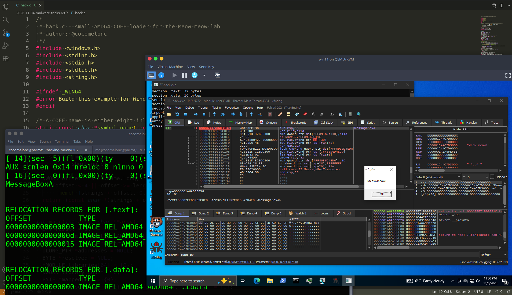{:class="img-responsive"}     

In [trick 68](/malware/2026/11/02/malware-tricks-68.html), we prepared a complete DLL inside another module's image mapping. We copied sections, resolved imports and applied PE base relocations before calling the replacement entry point. Today I want to move one step earlier in the build process: what happens if our input is an object file that has never been linked into a DLL?    

As usual, the visible result will be a `Meow-meow!` message box with the `=^..^=` caption. This time the payload is `meow.o`, an AMD64 COFF object compiled from C. A second object will print a message through `KERNEL32`, using exactly the same loader executable.    

### a few words before we start

A DLL is a linked PE image. A COFF object is input to a linker: it contains sections, symbols, unresolved references and relocation records. The object does not provide the DLL import directory, `DllMain` initialization contract or PE optional header used in the previous experiment. Microsoft's [PE/COFF specification](https://learn.microsoft.com/en-us/windows/win32/debug/pe-format) describes both formats.    

We need a little linking work at runtime. Our loader will place sections in memory, assign addresses to symbols, resolve explicitly named DLL imports, patch references and call a selected C function.    

The files are:    

- `hack.c`: the loader; accepts an object filename and an optional entry symbol.    
- `meow.c`: the MessageBox example, compiled into `meow.o`.    
- `meow2.c`: a console example, compiled into `meow2.o`.    

The entry contract is `void go(void)`. Another entry name can be supplied on the command line, but its C signature must remain `void function(void)`. No byte sequence, function offset, MessageBox import or DLL name is fixed inside the loader.    

### concept

Here is the sequence:    

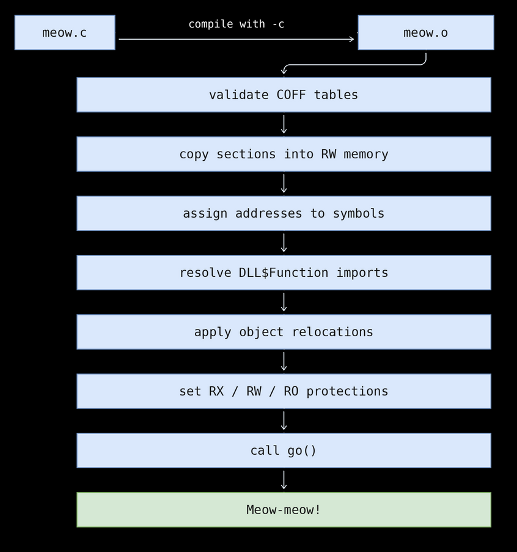{:class="img-responsive"}     

The loader runs in the current process. It allocates private memory for the object; there is no carrier DLL or remote process in this example. That difference will also be visible when inspecting the memory map.    

### practical example 1: the Meow-meow object

First, declare the external API used by our object:    

```c
DECLSPEC_IMPORT int WINAPI cat_box(HWND, LPCSTR, LPCSTR, UINT)
  __asm__("USER32$MessageBoxA");
```

`cat_box` is the identifier in our C source. The GCC assembler label gives it the external name `USER32$MessageBoxA`; `dllimport` makes the generated code refer to the pointer symbol `__imp_USER32$MessageBoxA`. This declaration contains no handwritten assembly instructions. See GCC's [assembler labels documentation](https://gcc.gnu.org/onlinedocs/gcc/Asm-Labels.html).    

The `DLL$Function` spelling is our explicit import convention. COFF itself does not tell us which DLL owns an arbitrary undefined symbol, so our loader does not guess whether a function belongs to `USER32`, `KERNEL32` or another library.    

Next, keep a data pointer that needs relocating:    

```c
static const char message[] = "Meow-meow!";
static const char *volatile text = message;
```

The pointer value initially describes an address within the object's section layout. Once sections have real runtime addresses, the loader must fix that value. `volatile` keeps the function's read of the pointer visible in this small optimized example.    

Finally, `go()` calls the API and returns normally:    

```c
void go(void) {
  cat_box(NULL, text, "=^..^=", MB_OK);
}
```

Now the complete payload (`meow.c`):    

```c
/*
 * meow.c - Meow-meow COFF object
 * author: @cocomelonc
 */
#include <windows.h>

DECLSPEC_IMPORT int WINAPI cat_box(HWND, LPCSTR, LPCSTR, UINT)
  __asm__("USER32$MessageBoxA");

static const char message[] = "Meow-meow!";
static const char *volatile text = message;

void go(void) {
  cat_box(NULL, text, "=^..^=", MB_OK);
}
```

Let's walk through the important parts before putting the complete logic together.    

First of all we need to read the object and validate its tables.     

The file starts with `IMAGE_FILE_HEADER`. We do not look for an `MZ` header or follow `e_lfanew`:    

```c
IMAGE_FILE_HEADER *header = (IMAGE_FILE_HEADER *)raw;
WORD count = header->NumberOfSections;
DWORD symbol_count = header->NumberOfSymbols;
```

The complete source checks for AMD64, a zero optional-header size and bounded section and symbol tables. Limits are `16 MiB` for the file and mapped allocation, `32` sections, `4096` symbol records and `64` imported symbol resolutions. Every successful `LoadLibraryA` is matched by a `FreeLibrary` during cleanup.    

The symbol table is followed by a string table whose first four bytes contain its total size, including that length field. Symbol names can be eight inline bytes or offsets into that table. Section names longer than eight bytes use a `/decimal-offset` representation. Both forms are checked before use.    

Then, we need to give every section a runtime address.      

Each section starts on its own page boundary inside one allocation. This lets code become executable and read-only while writable data stays on separate pages. The allocation also leaves space for import-pointer slots:    

```c
memory = VirtualAlloc(NULL, total, MEM_RESERVE | MEM_COMMIT, PAGE_READWRITE);
ULONG_PTR *slots = (ULONG_PTR *)(memory + slot_offset);
```

Initialized sections are copied from the file. Uninitialized data such as `.bss` keeps the zero bytes supplied by `VirtualAlloc`. A zero raw-file pointer for `.bss` is not an instruction to copy the COFF header into that section.    

The allocation is contiguous so that references between our sections and import slots remain within the signed 32-bit range used by RIP-relative instructions.    

Then, resolve defined symbols and skip auxiliary records.    

A symbol with a positive section number refers to one of our mapped sections. Section numbers start at one:    

```c
addresses[i] = (ULONG_PTR)mapped[n] + s->Value;
resolved[i] = 1;
```

COFF auxiliary records occupy symbol-table indices too. We skip them using `NumberOfAuxSymbols`, preserving the original indices used by relocation records. We never renumber the symbol table after removing auxiliary entries.    

```c
i += 1 + s->NumberOfAuxSymbols;
```

The loader locates the chosen entry symbol in an executable section. It does not use a fixed offset such as `object + 0x1000`.    

Resolve imports from the object. For an undefined external, the loader requires our `__imp_DLL$Function` convention. It separates the library and export names, then uses the ordinary Windows APIs:    

```c
HMODULE library = LoadLibraryA(import);
FARPROC address = GetProcAddress(library, function);
slots[i] = (ULONG_PTR)address;
addresses[i] = (ULONG_PTR)&slots[i];
```

The distinction between the last two lines matters. The slot contains the API's address. The COFF import symbol resolves to the address of that slot, because generated code performs an indirect call or jump through it.    

```text
instruction -- RIP-relative reference --> local slot -- pointer --> Windows API
```

Resolving `__imp_...` directly to the API address would give the generated instruction the wrong level of indirection. A direct displacement to a DLL export may also exceed the instruction's signed 32-bit range.    

There is no `MessageBoxA` special case in this code. Every supported import follows the same path, and the slots are private loader data rather than a PE import directory.    

At this step, apply COFF relocations. These are object-file relocation records. They describe unresolved references inside sections; they are different from the PE base-relocation blocks used in [trick 68](/malware/2026/11/02/malware-tricks-68.html)    

For `IMAGE_REL_AMD64_ADDR64`:    

```bash
patched 64-bit value = symbol address + existing addend
```

For `IMAGE_REL_AMD64_REL32` and `REL32_1` through `REL32_5`:    

```bash
patched signed displacement = S + A - (P + 4 + n)

S = resolved symbol address
A = signed addend already stored in the relocation field
P = address of that field in our mapped section
n = 0 for REL32, 1..5 for the numbered variants
```

The range check is required. A result that does not fit in `int32_t` cannot be repaired by truncating it. Unsupported relocation types are rejected.    

Our MessageBox object exercises both families: RIP-relative references in `.text`, and an absolute pointer in `.data`.    

Protect the sections and call the entry. After patching, executable sections become `PAGE_EXECUTE_READ`, writable data becomes `PAGE_READWRITE`, and other sections become `PAGE_READONLY`. Import slots also become read-only. Sections requesting both write and execute permissions are rejected.    

The loader flushes the instruction cache and pauses before the call:    

```c
printf("press Enter to call the object...\n");
getchar();
entry();
```

The pause gives us time to attach x64dbg and examine the printed entry address. After `go()` returns, the loader frees the allocation and releases its DLL references. The object must finish all work before returning; it cannot leave a worker executing from memory that is about to be freed.    

Now the complete full source code looks like this (`hack.c`):    

```c
/*
 * hack.c - small AMD64 COFF loader for the Meow-meow
 * author: @cocomelonc
 */
#include <windows.h>
#include <stdint.h>
#include <stdio.h>
#include <stdlib.h>
#include <string.h>

#ifndef _WIN64
#error Build this example for Windows x64.
#endif

/* a COFF name is either eight inline bytes or an offset into the string table. */
static const char *symbol_name(const IMAGE_SYMBOL *s, const BYTE *strings,
                               DWORD length, char short_name[9]) {
  if (s->N.Name.Short) {
    memcpy(short_name, s->N.ShortName, 8);
    short_name[8] = 0;
    return short_name;
  }
  DWORD offset = s->N.Name.Long;
  if (offset < 4 || offset >= length ||
      !memchr(strings + offset, 0, length - offset)) return NULL;
  return (const char *)strings + offset;
}

int main(int argc, char **argv) {
  int result = 1;
  HANDLE file = INVALID_HANDLE_VALUE;
  BYTE *raw = NULL, *memory = NULL;
  ULONG_PTR *addresses = NULL;
  BYTE *resolved = NULL;
  HMODULE libraries[64] = {0};
  DWORD library_count = 0;
  BYTE *mapped[32] = {0};
  SIZE_T offsets[32] = {0}, spans[32] = {0}, sizes[32] = {0};
  const char *entry_name = argc == 3 ? argv[2] : "go";
  void (*entry)(void) = NULL;
  SYSTEM_INFO system;
  LARGE_INTEGER length;
  DWORD bytes = 0, old = 0;

  if (argc < 2 || argc > 3) {
    printf("usage: %s object.o [entry-symbol]\n", argv[0]);
    return 1;
  }
  GetSystemInfo(&system);
  SIZE_T page = system.dwPageSize;
  file = CreateFileA(argv[1], GENERIC_READ, FILE_SHARE_READ, NULL,
                     OPEN_EXISTING, FILE_ATTRIBUTE_NORMAL, NULL);
  if (file == INVALID_HANDLE_VALUE) {
    printf("CreateFileA failed: %lu\n", GetLastError());
    goto cleanup;
  }
  if (!GetFileSizeEx(file, &length) || length.QuadPart < (LONGLONG)sizeof(IMAGE_FILE_HEADER) ||
      length.QuadPart > 16 * 1024 * 1024) {
    printf("invalid object size\n");
    goto cleanup;
  }
  SIZE_T file_size = (SIZE_T)length.QuadPart;
  raw = malloc(file_size);
  if (!raw || !ReadFile(file, raw, (DWORD)file_size, &bytes, NULL) ||
      bytes != file_size) {
    printf("could not read the object\n");
    goto cleanup;
  }
  IMAGE_FILE_HEADER *header = (IMAGE_FILE_HEADER *)raw;
  WORD count = header->NumberOfSections;
  DWORD symbol_count = header->NumberOfSymbols;
  SIZE_T section_end = sizeof(*header) + (SIZE_T)count * sizeof(IMAGE_SECTION_HEADER);
  if (header->Machine != IMAGE_FILE_MACHINE_AMD64 || header->SizeOfOptionalHeader ||
      !count || count > 32 || !symbol_count || symbol_count > 4096 ||
      section_end > file_size || header->PointerToSymbolTable < section_end ||
      header->PointerToSymbolTable > file_size ||
      symbol_count > (file_size - header->PointerToSymbolTable) / sizeof(IMAGE_SYMBOL)) {
    printf("expected an ordinary AMD64 COFF object\n");
    goto cleanup;
  }
  IMAGE_SECTION_HEADER *sections = (IMAGE_SECTION_HEADER *)(raw + sizeof(*header));
  IMAGE_SYMBOL *symbols = (IMAGE_SYMBOL *)(raw + header->PointerToSymbolTable);
  SIZE_T string_offset = header->PointerToSymbolTable +
                        (SIZE_T)symbol_count * sizeof(IMAGE_SYMBOL);
  if (file_size - string_offset < sizeof(DWORD)) {
    printf("missing string table\n");
    goto cleanup;
  }
  DWORD string_size;
  memcpy(&string_size, raw + string_offset, sizeof(string_size));
  BYTE *strings = raw + string_offset;
  if (string_size < 4 || string_size > file_size - string_offset) {
    printf("invalid string table\n");
    goto cleanup;
  }

  SIZE_T total = 0;
  for (WORD i = 0; i < count; i++) {
    IMAGE_SECTION_HEADER *s = &sections[i];
    char short_name[9] = {0};
    memcpy(short_name, s->Name, 8);
    const char *name = short_name;
    if (short_name[0] == '/') {
      char *end;
      unsigned long offset = strtoul(short_name + 1, &end, 10);
      if (end == short_name + 1 || *end || offset < 4 || offset >= string_size ||
          !memchr(strings + offset, 0, string_size - offset)) {
        printf("invalid section name\n");
        goto cleanup;
      }
      name = (const char *)strings + offset;
    }
    DWORD flags = s->Characteristics;
    unsigned alignment = (flags >> 20) & 15;
    if (!strncmp(name, ".pdata", 6) || !strncmp(name, ".xdata", 6) ||
        !strncmp(name, ".tls", 4) || !strncmp(name, ".CRT", 4) ||
        !strncmp(name, ".ctors", 6) || !strncmp(name, ".dtors", 6) ||
        !strcmp(name, ".drectve") || alignment == 15 ||
        (alignment && ((SIZE_T)1 << (alignment - 1)) > page) ||
        (flags & (IMAGE_SCN_LNK_COMDAT | IMAGE_SCN_LNK_NRELOC_OVFL)) ||
        ((flags & IMAGE_SCN_MEM_EXECUTE) && (flags & IMAGE_SCN_MEM_WRITE))) {
      printf("unsupported section: %s\n", name);
      goto cleanup;
    }
    sizes[i] = s->SizeOfRawData;
    if (s->Misc.VirtualSize > sizes[i]) sizes[i] = s->Misc.VirtualSize;
    if (sizes[i] > 16 * 1024 * 1024 ||
        (s->SizeOfRawData && !(flags & IMAGE_SCN_CNT_UNINITIALIZED_DATA) &&
         (s->PointerToRawData < section_end || s->PointerToRawData > file_size ||
          s->SizeOfRawData > file_size - s->PointerToRawData)) ||
        (s->NumberOfRelocations &&
         (s->PointerToRelocations < section_end || s->PointerToRelocations > file_size ||
          s->NumberOfRelocations >
          (file_size - s->PointerToRelocations) / sizeof(IMAGE_RELOCATION)))) {
      printf("invalid section ranges\n");
      goto cleanup;
    }
    spans[i] = sizes[i] ? (sizes[i] + page - 1) / page * page : page;
    offsets[i] = total;
    total += spans[i];
    printf("section %s: %llu bytes\n", name, (unsigned long long)sizes[i]);
  }
  SIZE_T slot_offset = total;
  SIZE_T slot_size = ((SIZE_T)symbol_count * sizeof(ULONG_PTR) + page - 1) / page * page;
  total += slot_size;
  if (total > 16 * 1024 * 1024) {
    printf("object needs too much memory\n");
    goto cleanup;
  }
  memory = VirtualAlloc(NULL, total, MEM_RESERVE | MEM_COMMIT, PAGE_READWRITE);
  addresses = calloc(symbol_count, sizeof(*addresses));
  resolved = calloc(symbol_count, sizeof(*resolved));
  if (!memory || !addresses || !resolved) {
    printf("allocation failed\n");
    goto cleanup;
  }
  ULONG_PTR *slots = (ULONG_PTR *)(memory + slot_offset);
  for (WORD i = 0; i < count; i++) {
    mapped[i] = memory + offsets[i];
    if (sections[i].SizeOfRawData &&
        !(sections[i].Characteristics & IMAGE_SCN_CNT_UNINITIALIZED_DATA))
      memcpy(mapped[i], raw + sections[i].PointerToRawData, sections[i].SizeOfRawData);
  }

  for (DWORD i = 0; i < symbol_count;) {
    IMAGE_SYMBOL *s = &symbols[i];
    char short_name[9];
    const char *name = symbol_name(s, strings, string_size, short_name);
    if (!name || s->NumberOfAuxSymbols > symbol_count - i - 1) {
      printf("invalid symbol record\n");
      goto cleanup;
    }
    if (s->SectionNumber > 0) {
      WORD n = (WORD)(s->SectionNumber - 1);
      if (n >= count || s->Value > sizes[n]) {
        printf("symbol outside its section: %s\n", name);
        goto cleanup;
      }
      addresses[i] = (ULONG_PTR)mapped[n] + s->Value;
      resolved[i] = 1;
      if (!strcmp(name, entry_name) && s->Type == 0x20 &&
          (sections[n].Characteristics & IMAGE_SCN_MEM_EXECUTE) && s->Value < sizes[n]) {
        if (entry) {
          printf("duplicate entry symbol\n");
          goto cleanup;
        }
        entry = (void (*)(void))addresses[i];
      }
    } else if (s->SectionNumber == IMAGE_SYM_ABSOLUTE) {
      addresses[i] = s->Value;
      resolved[i] = 1;
    } else if (s->SectionNumber == IMAGE_SYM_UNDEFINED) {
      char import[256];
      if (s->StorageClass != IMAGE_SYM_CLASS_EXTERNAL || s->Value ||
          strncmp(name, "__imp_", 6) || strlen(name + 6) >= sizeof(import)) {
        printf("unsupported external: %s\n", name);
        goto cleanup;
      }
      strcpy(import, name + 6);
      char *function = strchr(import, '$');
      if (!function || function == import || !function[1] ||
          strchr(function + 1, '$') || function[1] == '#' || library_count == 64) {
        printf("expected __imp_DLL$Function: %s\n", name);
        goto cleanup;
      }
      *function++ = 0;
      for (const char *p = import; *p; p++) {
        if (!((*p >= 'A' && *p <= 'Z') || (*p >= 'a' && *p <= 'z') ||
              (*p >= '0' && *p <= '9') || *p == '_' || *p == '-' || *p == '.')) {
          printf("invalid DLL name\n");
          goto cleanup;
        }
      }
      HMODULE library = LoadLibraryA(import);
      if (!library) {
        printf("LoadLibraryA(%s) failed: %lu\n", import, GetLastError());
        goto cleanup;
      }
      libraries[library_count++] = library;
      FARPROC address = GetProcAddress(library, function);
      if (!address) {
        printf("GetProcAddress(%s) failed: %lu\n", function, GetLastError());
        goto cleanup;
      }
      slots[i] = (ULONG_PTR)address;
      addresses[i] = (ULONG_PTR)&slots[i];
      resolved[i] = 1;
      printf("import %s!%s -> slot %p\n", import, function, (void *)&slots[i]);
    } else if (s->SectionNumber != IMAGE_SYM_DEBUG) {
      printf("unsupported symbol: %s\n", name);
      goto cleanup;
    }
    i += 1 + s->NumberOfAuxSymbols;
  }

  DWORD relocation_count = 0;
  for (WORD i = 0; i < count; i++) {
    IMAGE_SECTION_HEADER *s = &sections[i];
    if (!s->NumberOfRelocations) continue;
    IMAGE_RELOCATION *relocations = (IMAGE_RELOCATION *)(raw + s->PointerToRelocations);
    for (WORD j = 0; j < s->NumberOfRelocations; j++) {
      IMAGE_RELOCATION *r = &relocations[j];
      if (r->Type == IMAGE_REL_AMD64_ABSOLUTE) continue;
      SIZE_T width;
      if (r->Type == IMAGE_REL_AMD64_ADDR64) width = 8;
      else if (r->Type >= IMAGE_REL_AMD64_REL32 && r->Type <= IMAGE_REL_AMD64_REL32_5)
        width = 4;
      else {
        printf("unsupported relocation: 0x%04x\n", r->Type);
        goto cleanup;
      }
      if (r->SymbolTableIndex >= symbol_count || !resolved[r->SymbolTableIndex] ||
          r->VirtualAddress > sizes[i] || width > sizes[i] - r->VirtualAddress) {
        printf("invalid relocation target\n");
        goto cleanup;
      }
      BYTE *patch = mapped[i] + r->VirtualAddress;
      ULONG_PTR target = addresses[r->SymbolTableIndex];
      if (width == 8) {
        uint64_t addend;
        memcpy(&addend, patch, 8);
        addend += (uint64_t)target;
        memcpy(patch, &addend, 8);
      } else {
        int32_t addend;
        memcpy(&addend, patch, 4);
        unsigned extra = r->Type - IMAGE_REL_AMD64_REL32;
        int64_t value = (int64_t)target + addend - (int64_t)(ULONG_PTR)(patch + 4 + extra);
        if (value < INT32_MIN || value > INT32_MAX) {
          printf("REL32 target is out of range\n");
          goto cleanup;
        }
        int32_t displacement = (int32_t)value;
        memcpy(patch, &displacement, 4);
      }
      relocation_count++;
    }
  }
  if (!entry) {
    printf("entry symbol not found: %s\n", entry_name);
    goto cleanup;
  }
  for (WORD i = 0; i < count; i++) {
    DWORD flags = sections[i].Characteristics;
    DWORD protection = (flags & IMAGE_SCN_MEM_EXECUTE) ? PAGE_EXECUTE_READ :
                       (flags & IMAGE_SCN_MEM_WRITE) ? PAGE_READWRITE : PAGE_READONLY;
    if (!VirtualProtect(mapped[i], spans[i], protection, &old)) {
      printf("VirtualProtect failed: %lu\n", GetLastError());
      goto cleanup;
    }
  }
  if (!VirtualProtect(slots, slot_size, PAGE_READONLY, &old) ||
      !FlushInstructionCache(GetCurrentProcess(), memory, total)) {
    printf("finalizing memory failed: %lu\n", GetLastError());
    goto cleanup;
  }
  printf("applied %lu relocations\nentry %s: %p\n", relocation_count,
         entry_name, (void *)entry);
  printf("press Enter to call the object...\n");
  getchar();
  entry();
  printf("object returned; releasing memory\n");
  result = 0;

cleanup:
  if (memory) VirtualFree(memory, 0, MEM_RELEASE);
  while (library_count) FreeLibrary(libraries[--library_count]);
  free(resolved);
  free(addresses);
  free(raw);
  if (file != INVALID_HANDLE_VALUE) CloseHandle(file);
  return result;
}
```

### demo 1

First of all, compile the object on Linux:    

```bash
x86_64-w64-mingw32-gcc -std=c11 -Wall -Wextra -O2 -c -fno-stack-protector -fno-asynchronous-unwind-tables -fno-unwind-tables meow.c -o meow.o
```

`-c` stops before linking. There is no `-shared`, `--entry=DllMain` or `-luser32` here. The import stays unresolved in the object and will be handled by our loader. The unwind flags keep `.pdata` and `.xdata` out of these particular examples; the loader does not implement unwind registration.    

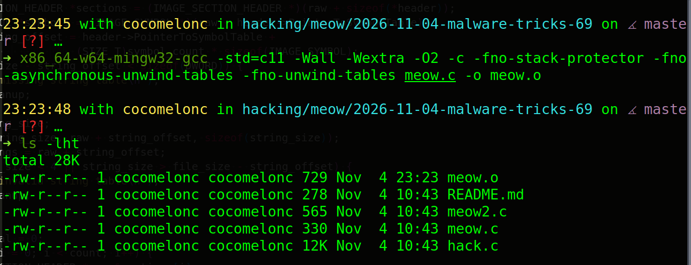{:class="img-responsive"}     

Inspect it before running anything:    

```bash
x86_64-w64-mingw32-objdump -h -t -r meow.o
```

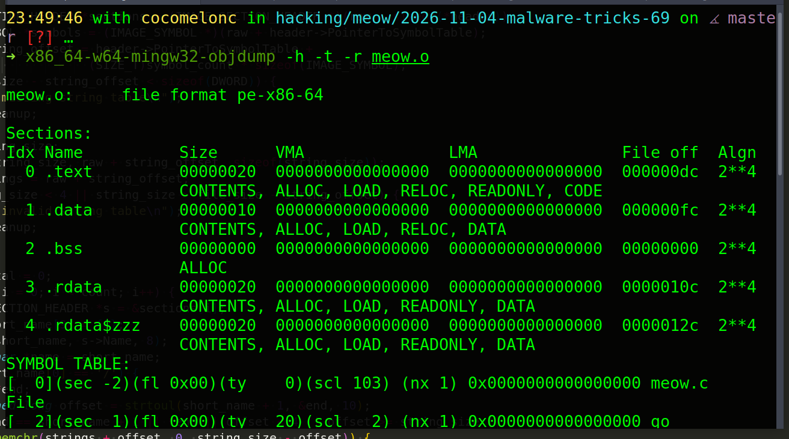{:class="img-responsive"}     

In my GCC 12 cross-build, the object has `.text`, `.data`, `.bss`, `.rdata` and `.rdata$zzz`. The unresolved API symbol is:    

```nasm
__imp_USER32$MessageBoxA
```

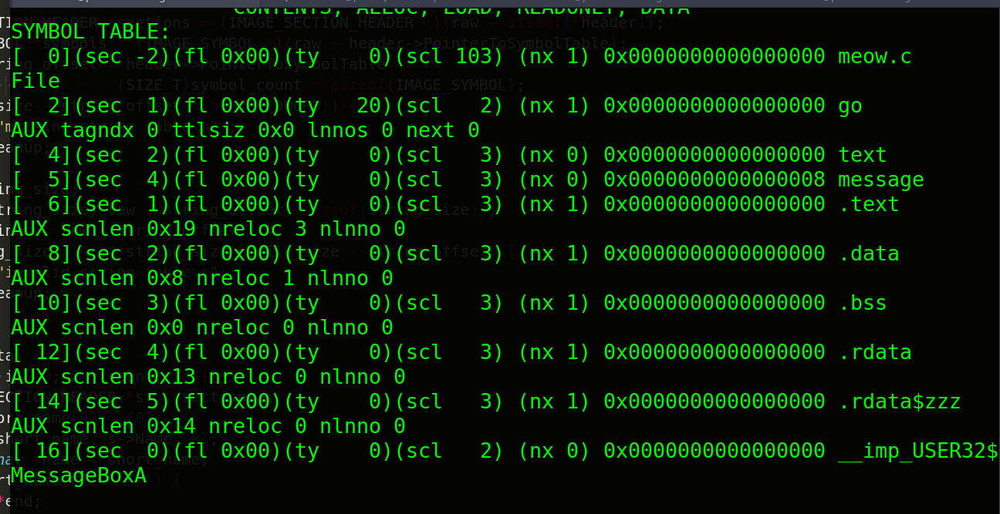{:class="img-responsive"}     

There are three `REL32` records in `.text` and one `ADDR64` record in `.data`. The `.data` pointer's addend is `8`, the offset of `message` inside `.rdata` in this build. Section padding, symbol indices and exact offsets may change with compiler versions.    

`objdump` identifies this object as `pe-x86-64`; a linked PE image is commonly shown as `pei-x86-64`. Neither that output label nor the `.o` suffix replaces checking the file structure.    

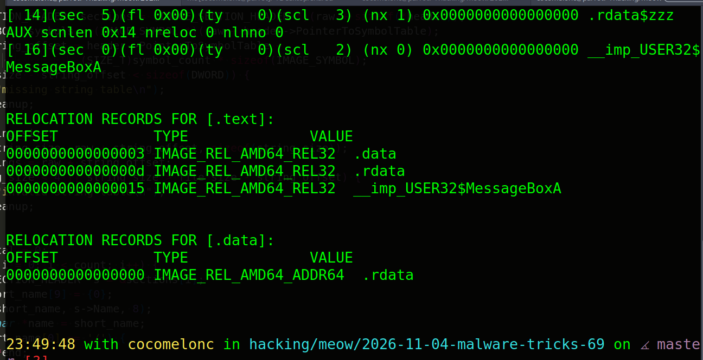{:class="img-responsive"}     

Compile the host:    

```bash
x86_64-w64-mingw32-gcc -std=c11 -Wall -Wextra -O2 hack.c -o hack.exe
```

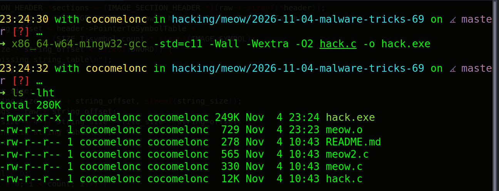{:class="img-responsive"}     

Copy `hack.exe` and `meow.o` into a Windows x64 lab folder. From that folder, run:    

```powershell
.\hack.exe meow.o
```

The loader should print section sizes, the resolved import slot, the relocation count and the entry address. With the object inspected above, the relevant lines should have this shape:    

```text
import USER32!MessageBoxA -> slot <runtime address>
applied 4 relocations
entry go: <runtime address>
press Enter to call the object...
```

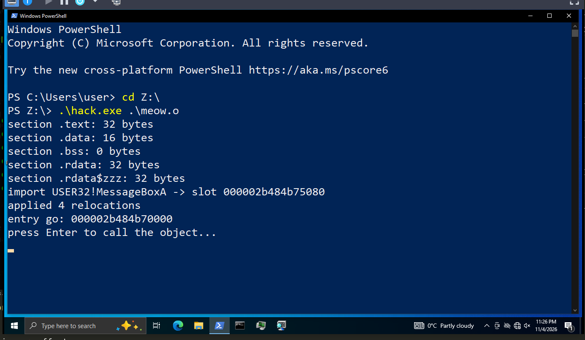{:class="img-responsive"}     

Press Enter. The expected result is our `Meow-meow!` messabebox dialog.    

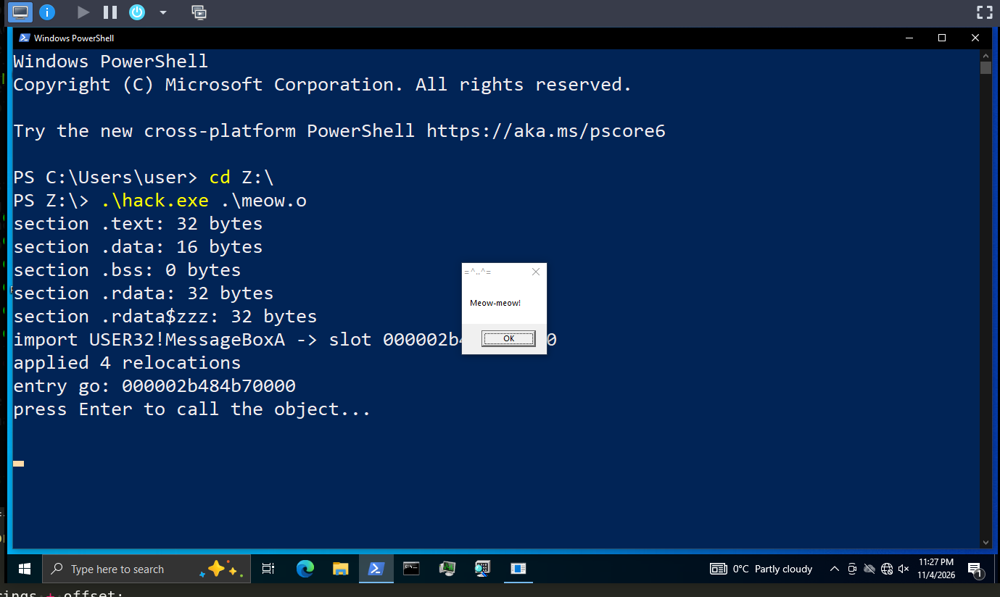{:class="img-responsive"}     

Close the dialog: execution should return to the loader, which prints:    

```text
object returned; releasing memory
```

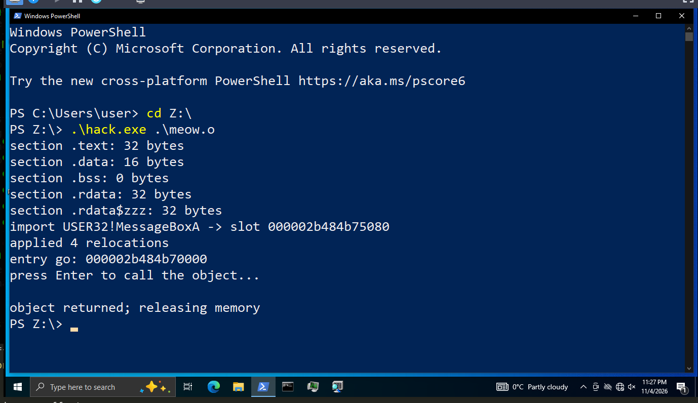{:class="img-responsive"}     

Let me explain the same experiment with the debugger. Put `hack.exe` and `meow.o` in `Z:\`. Open the x64 version of x64dbg and run this command:    

```bash
init "Z:\hack.exe", "meow.o", "Z:\"
```

The second argument is the command line passed to our program. The third is its working directory, where the loader will find `meow.o`.    

Stop before executing the object.     

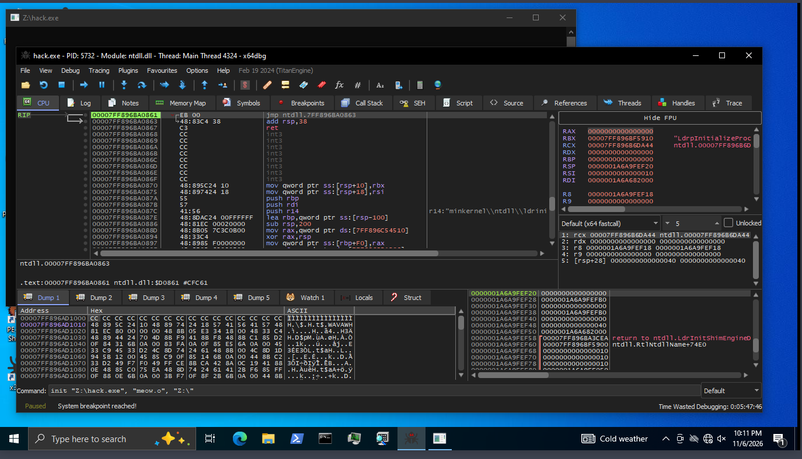{:class="img-responsive"}   

Press `F9` to run the program. Wait until its console displays:    

```bash
import USER32!MessageBoxA -> slot <runtime address>
applied 4 relocations
entry go: <runtime address>
press Enter to call the object...
```

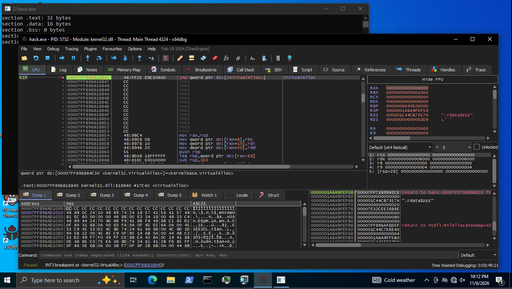{:class="img-responsive"}   

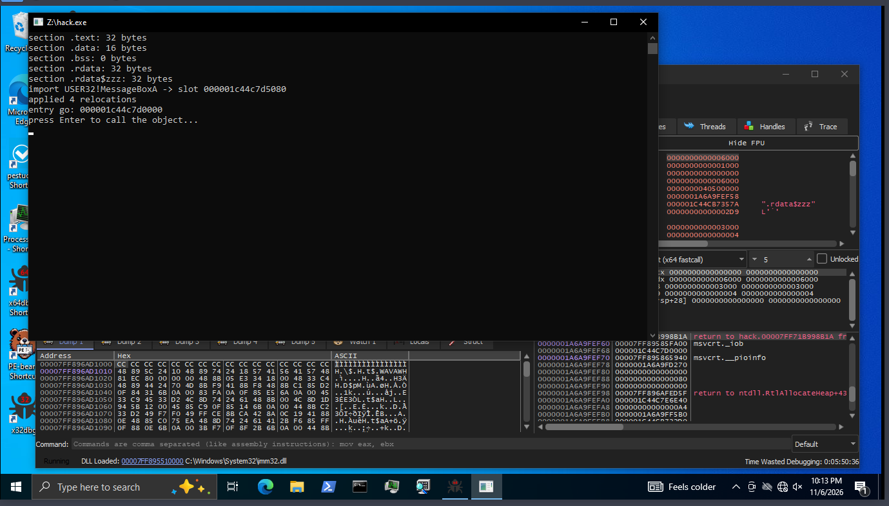{:class="img-responsive"}   

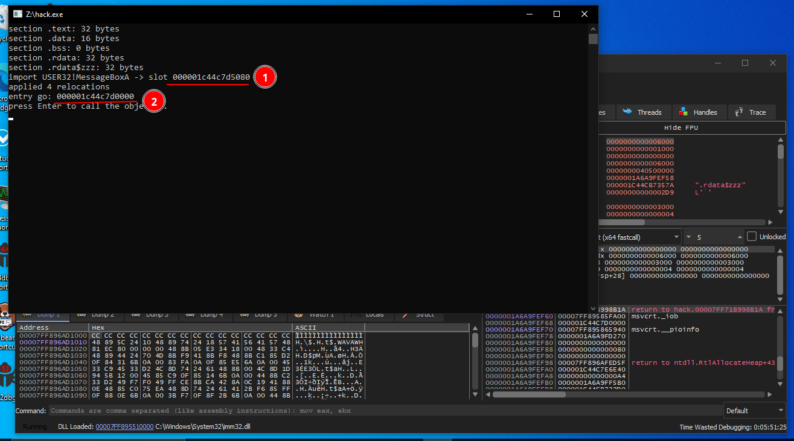{:class="img-responsive"}   

Leave the console waiting for Enter. Switch to x64dbg and press `F12` to pause the process. At this point the sections and import slot have already been prepared.    

Copy the two addresses printed by this run. In the following commands, replace each angle-bracket placeholder with the corresponding hexadecimal address, without the angle brackets:    

```bash
mov centry, <address printed after entry go:>
mov cslot, <address printed after slot>
```

`centry` is the runtime address of the object's function. `cslot` is the address of the local pointer slot for MessageBox. The variables are created automatically, and x64dbg interprets these address values as hexadecimal.    

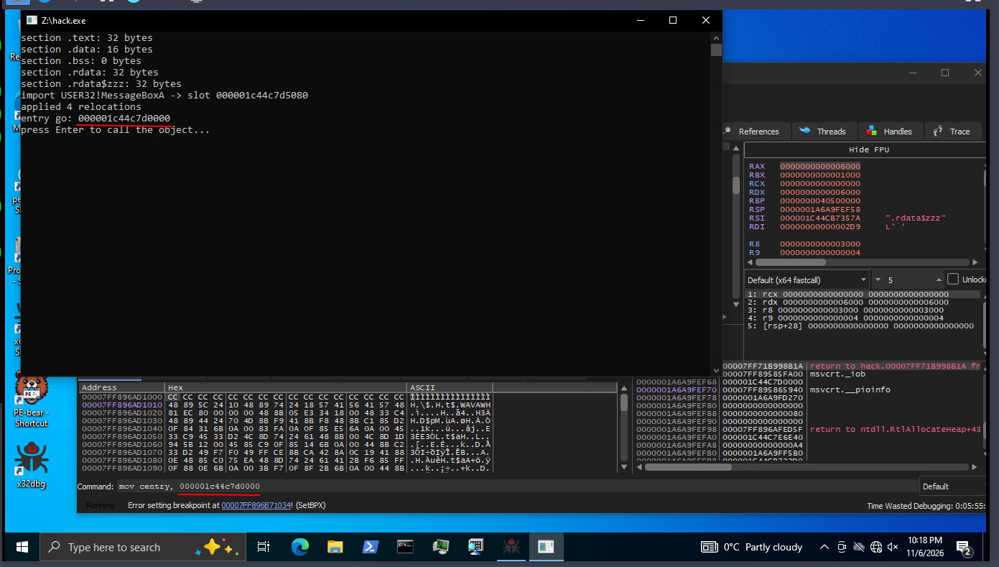{:class="img-responsive"}   

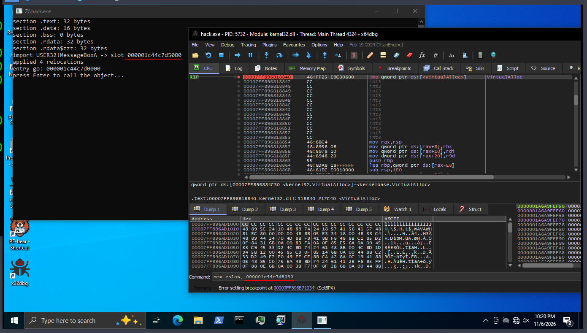{:class="img-responsive"}   

Then, let's examine the executable allocation.      

Navigate to the entry:    

```bash
disasm centry
```

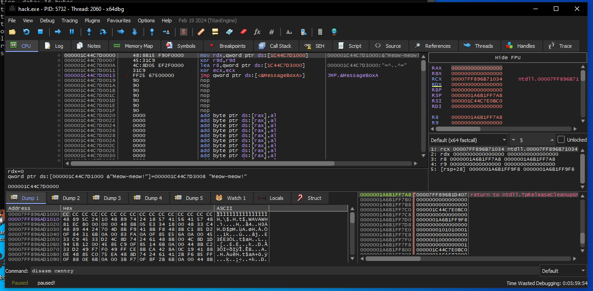{:class="img-responsive"}   

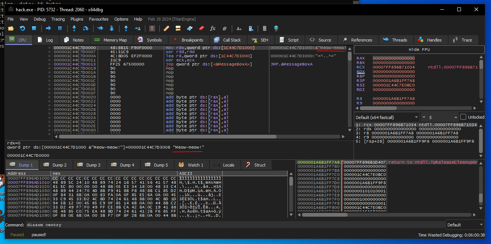{:class="img-responsive"}   

Open `Memory Map` and find the region containing `centry`. Its type should be private memory, corresponding to `MEM_PRIVATE`, and its code page should have execute/read protection. The exact labels depend on the debugger version.    

The allocation contains our mapped sections. The COFF header remains in the separate file buffer used by the parser. There is no PE header at a fixed offset before `go()`, so the `e_lfanew` commands from [trick 68](/malware/2026/11/02/malware-tricks-68.html) do not apply here. Find the object by its printed runtime address.    

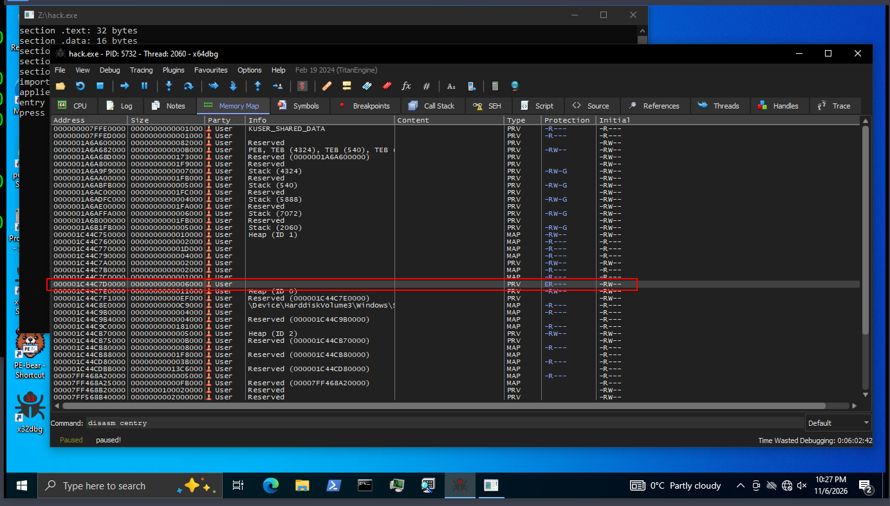{:class="img-responsive"}   

Display the slot, then follow the pointer it contains:    

```bash
dump cslot
disasm qword:[cslot]
```

The first command displays the eight-byte API pointer. The second navigates to that pointer's destination, which should resolve to `MessageBoxA` or its implementation. In `Memory Map`, the slot's page should be read-only.    

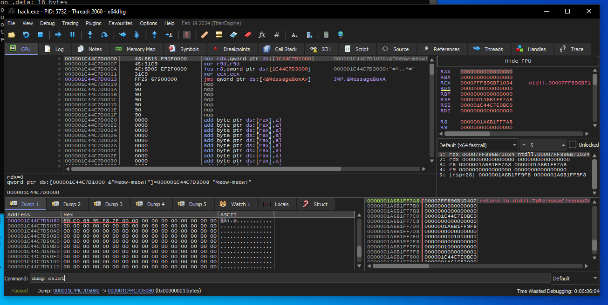{:class="img-responsive"}   

This lets us inspect both parts of the reference: an instruction in the object's code refers to a nearby slot, and the slot holds the address of a function in a loaded Windows DLL.    

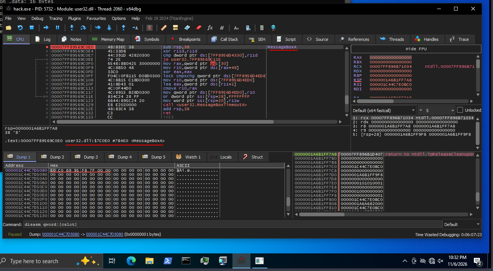{:class="img-responsive"}   

Now, inspect the relocated data pointer.     

Return to the entry disassembly:    

```bash
disasm centry
```

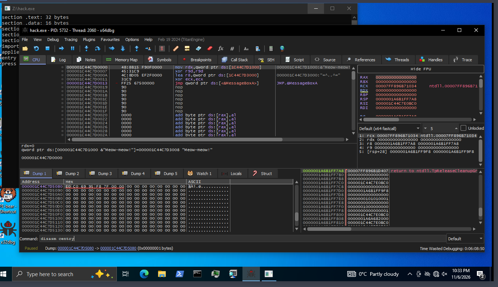{:class="img-responsive"}   

In the GCC 12 build inspected above, the first instruction loads `RDX` from a RIP-relative memory operand. That operand refers to the `text` variable in the mapped `.data` section. Use the instruction's context menu to follow the memory operand in Dump. Copy the effective address of the `text` variable:    

```bash
mov ctext, <address of the text variable in mapped .data>
dump ctext
dump qword:[ctext]
```

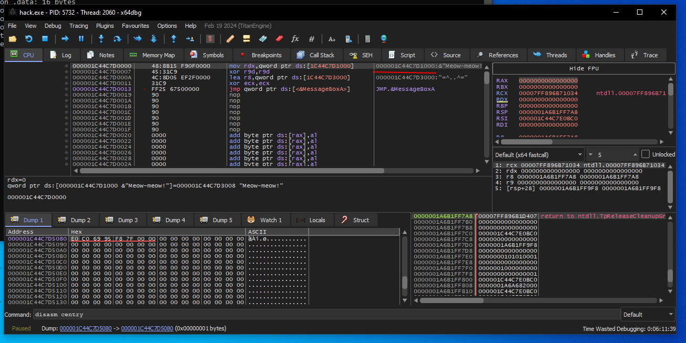{:class="img-responsive"}   

in my case:    

```bash
mov ctext, 000001C44C7D1000
dump ctext
dump qword:[ctext]
```

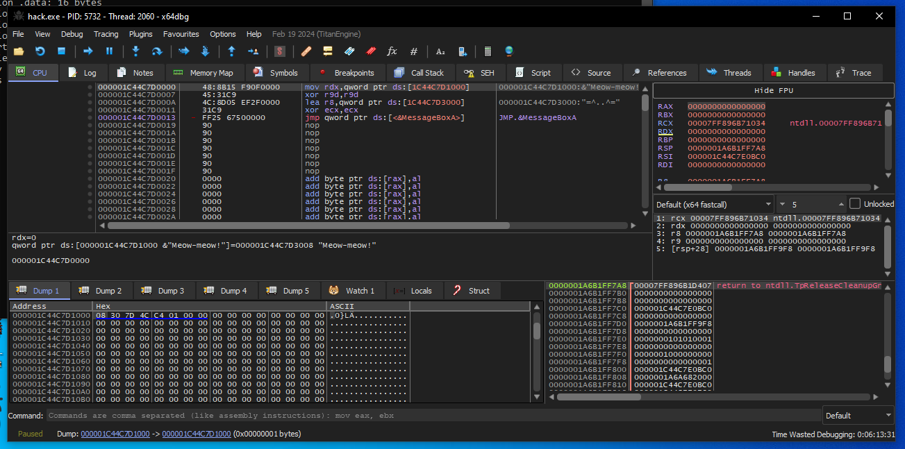{:class="img-responsive"}   

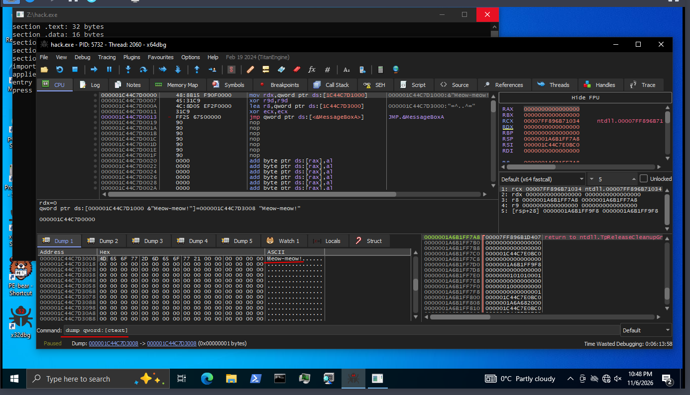{:class="img-responsive"}   

`dump ctext` shows the pointer value after the `ADDR64` relocation. Following that pointer should display `Meow-meow!` in the ASCII column. The pointer storage is in `.data`; the string it points to is in `.rdata`.    

Instruction offsets can change between compiler versions. Identify the data reference in your disassembly instead of assuming that a particular offset always contains it.    

Next step, break at `go()`.     

Set breakpoints on the object's entry and the API address obtained from its slot:    

```bash
bp centry
bp qword:[cslot]
```

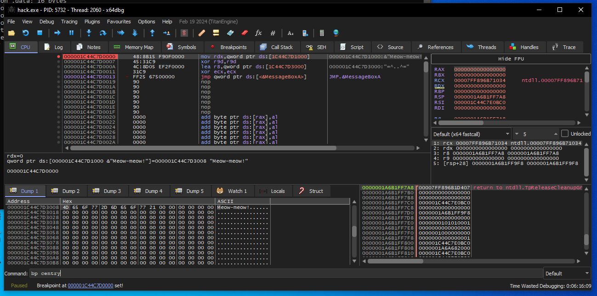{:class="img-responsive"}   

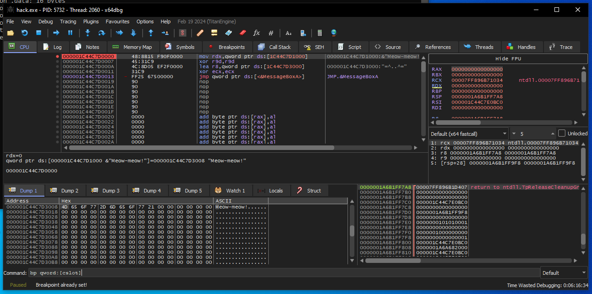{:class="img-responsive"}   

Press `F9` to resume the process. Switch to the console and press Enter once. The debugger should stop at `go()`.    

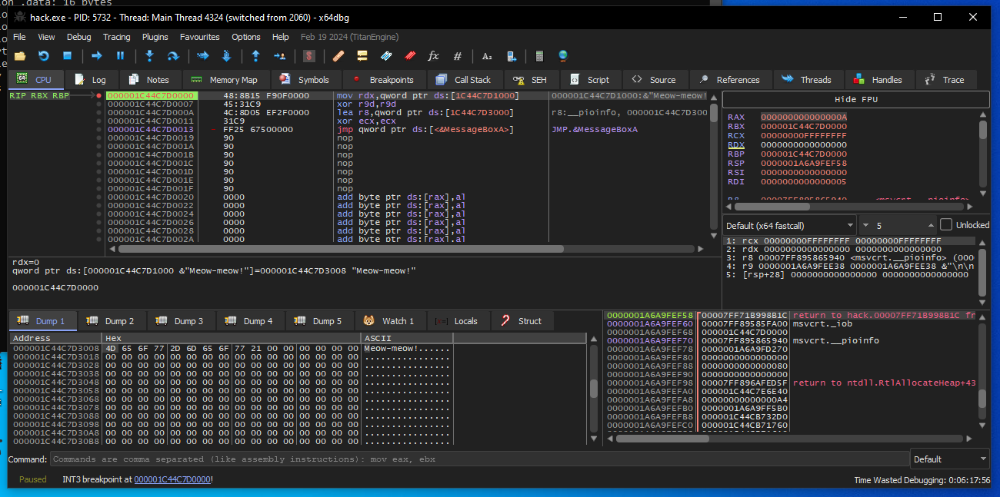{:class="img-responsive"}   

Our entry has the signature `void go(void)`, so there are no defined argument values to inspect in `RCX`, `RDX` or `R8` at this point. The `HINSTANCE` and `DLL_PROCESS_ATTACH` values from the previous DLL example are not part of this call.    

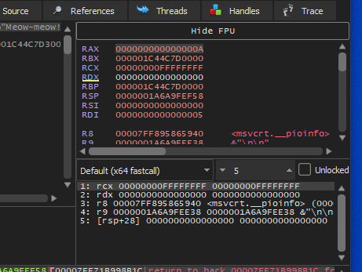{:class="img-responsive"}   

Before continuing, save the return address from the top of the stack and set a breakpoint there:    

```bash
mov cret, qword:[rsp]
bp cret
```

This breakpoint will let us observe control returning to the host after the object finishes. Set it at the entry breakpoint, before stepping through any function prologue.    

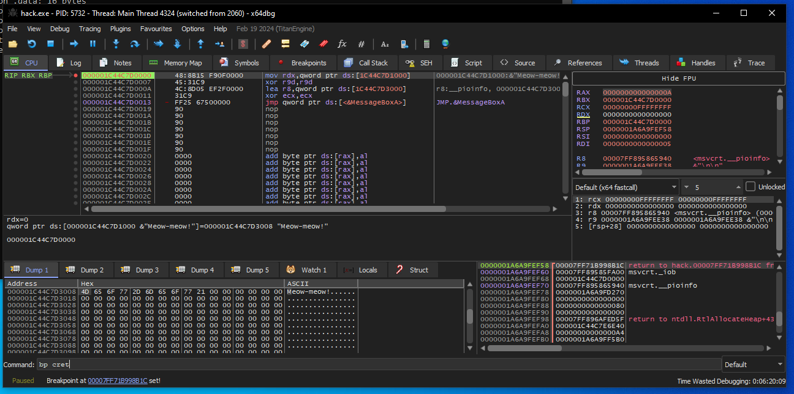{:class="img-responsive"}   

Then, let's inspect the MessageBox arguments now.         

Press `F9` again. At the API breakpoint, the expected argument registers are:    

```nasm
RCX = 0                         ; hWnd
RDX = pointer to "Meow-meow!"    ; lpText
R8  = pointer to "=^..^="        ; lpCaption
R9D = 0                         ; MB_OK
```

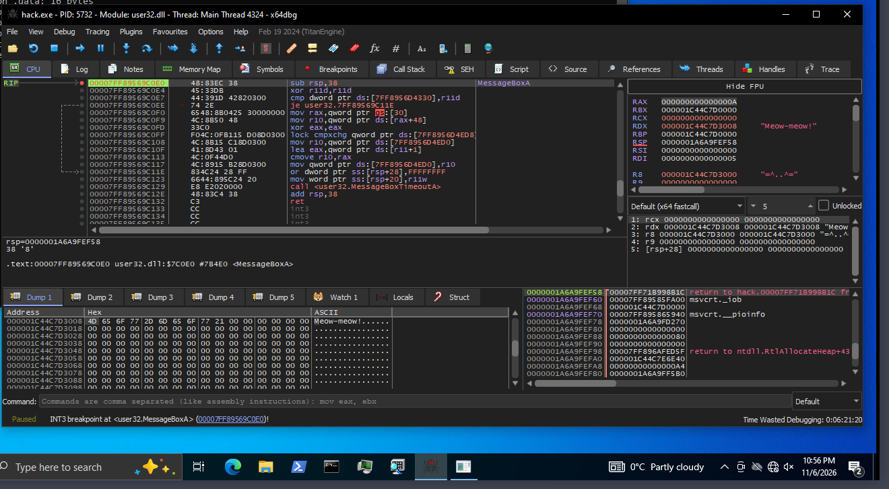{:class="img-responsive"}   

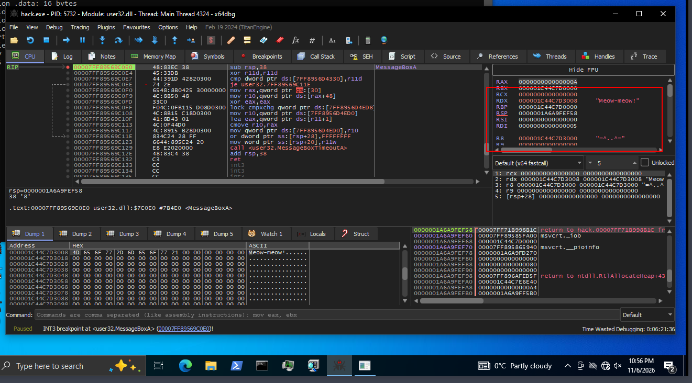{:class="img-responsive"}   

Follow the two strings:    

```bash
dump rdx
dump r8
```

This connects the C payload to the actual API call: the relocated data pointer supplies the message, and a RIP-relative reference supplies the caption. The optimized object may use a tail jump through the import slot; it still reaches the API with the expected arguments.    

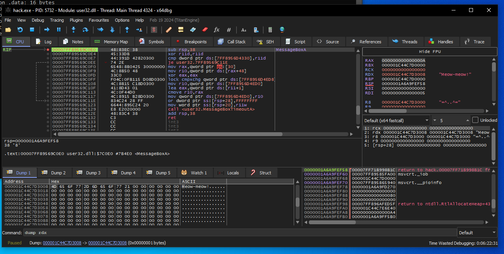{:class="img-responsive"}   

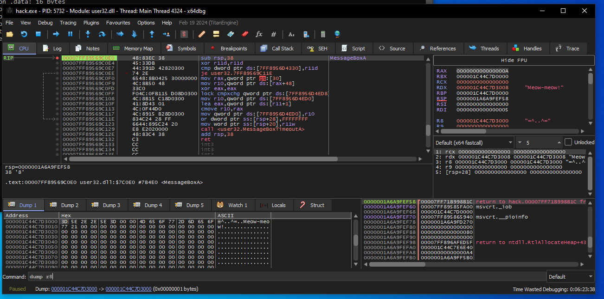{:class="img-responsive"}   

Finally, show the dialog and observe the return.    

Press `F9` to let the dialog appear. Close it. The debugger should stop at `cret`, the saved return address inside the host. Continue with `F9`; the console should print `object returned; releasing memory`.    

This completes the path we wanted to inspect: prepared COFF sections, resolved symbols, relocated references, execution of `go()`, the Windows API call and a normal return to the loader. The addresses are valid for this run only.    

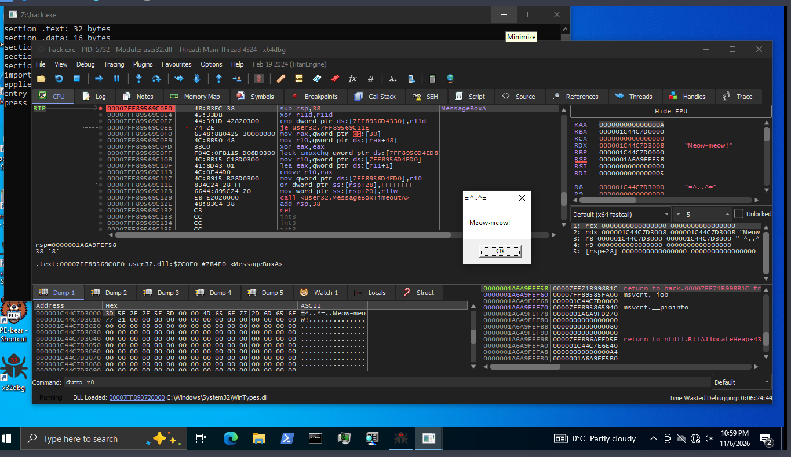{:class="img-responsive"}   

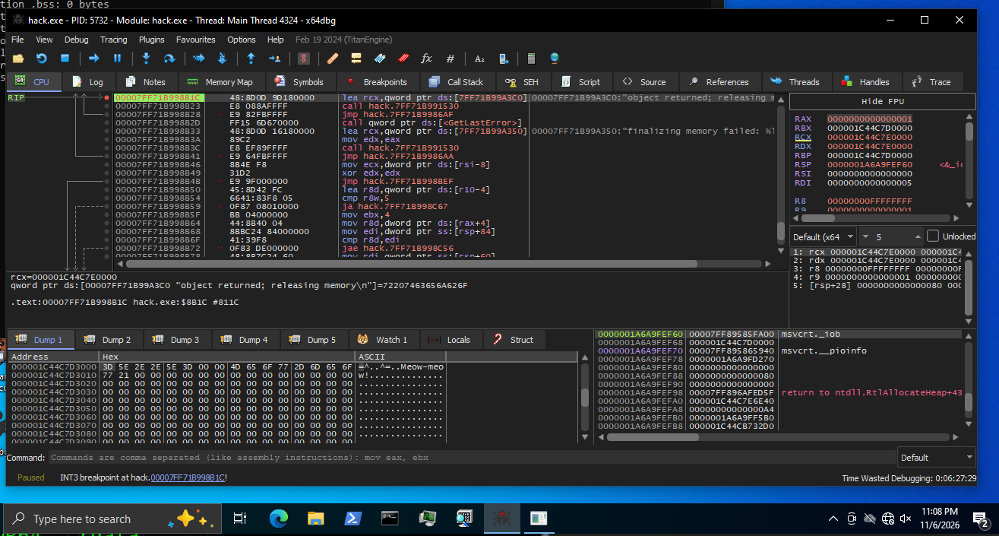{:class="img-responsive"}   

### practical example 2: change the object, keep the loader

Let's replace the dialog with console output. This object declares two imports from `KERNEL32`:    

```c
DECLSPEC_IMPORT HANDLE WINAPI cat_stdout(DWORD)
  __asm__("KERNEL32$GetStdHandle");
DECLSPEC_IMPORT BOOL WINAPI cat_write(HANDLE, LPCVOID, DWORD, LPDWORD, LPOVERLAPPED)
  __asm__("KERNEL32$WriteFile");
```

The function obtains the host's standard-output handle and writes a fixed message. A small uninitialized counter exercises `.bss`:    

```c
static volatile DWORD visits;
```

The loader supplies zeroed storage for that variable and resolves the two import symbols using the same convention as before. The object needs no CRT initialization.    

Now the complete second payload (`meow2.c`):    

```c
/*
 * meow2.c - console COFF object, without USER32
 * author: @cocomelonc
 */
#include <windows.h>

DECLSPEC_IMPORT HANDLE WINAPI cat_stdout(DWORD)
  __asm__("KERNEL32$GetStdHandle");
DECLSPEC_IMPORT BOOL WINAPI cat_write(HANDLE, LPCVOID, DWORD, LPDWORD, LPOVERLAPPED)
  __asm__("KERNEL32$WriteFile");

static volatile DWORD visits;

void go(void) {
  static const char message[] = "Meow-meow! This object uses KERNEL32.\r\n";
  DWORD written = 0;
  visits++;
  cat_write(cat_stdout(STD_OUTPUT_HANDLE), message, sizeof(message) - 1,
            &written, NULL);
}
```

### demo 2

Compile:    

```bash
x86_64-w64-mingw32-gcc -std=c11 -Wall -Wextra -O2 -c -fno-stack-protector -fno-asynchronous-unwind-tables -fno-unwind-tables meow2.c -o meow2.o
```

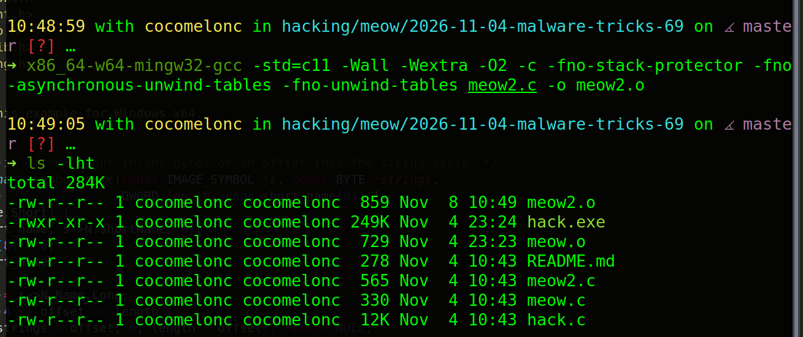{:class="img-responsive"}     

and inspect the second object:     

```bash
x86_64-w64-mingw32-objdump -h -t -r meow2.o
```

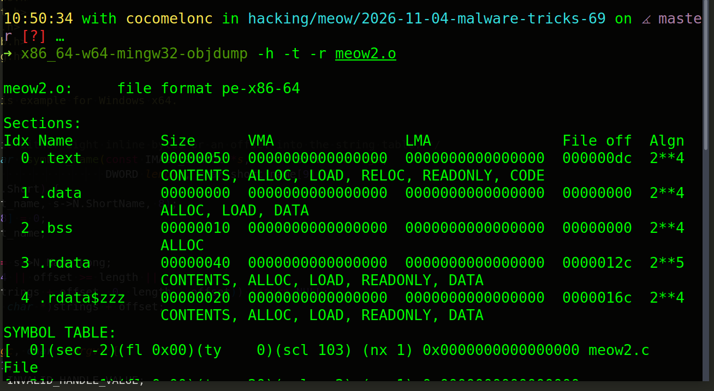{:class="img-responsive"}     

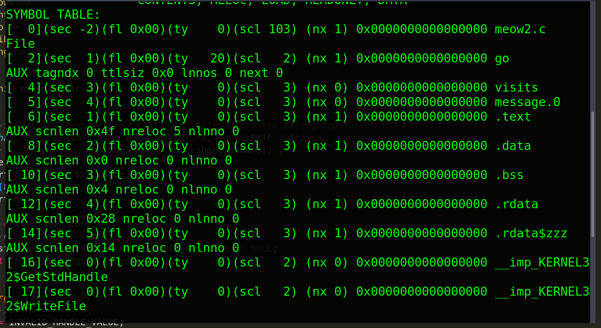{:class="img-responsive"}     

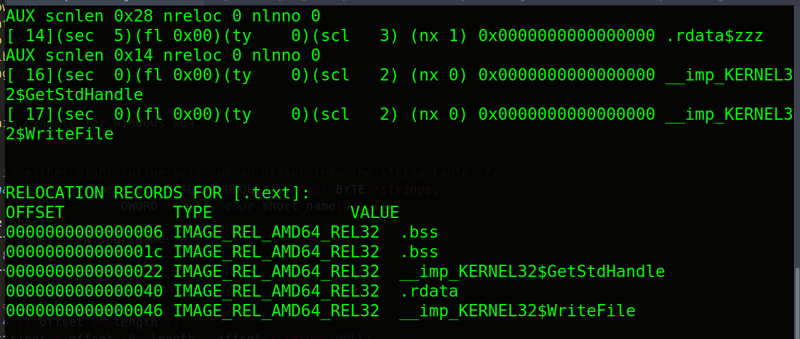{:class="img-responsive"}     

The GCC 12 object inspected locally contains these unresolved symbols:    

```text
__imp_KERNEL32$GetStdHandle
__imp_KERNEL32$WriteFile
```

Its five relocations are `REL32` references in `.text`, including references to `.bss`, the message and the two import slots. There is no `USER32` import in this object.    

{:class="img-responsive"}     

Copy `meow2.o` beside the existing `hack.exe` and run that same executable:    

```powershell
.\hack.exe meow2.o
```

After the loader prints the two resolved imports and pauses, press Enter. The expected output includes:    

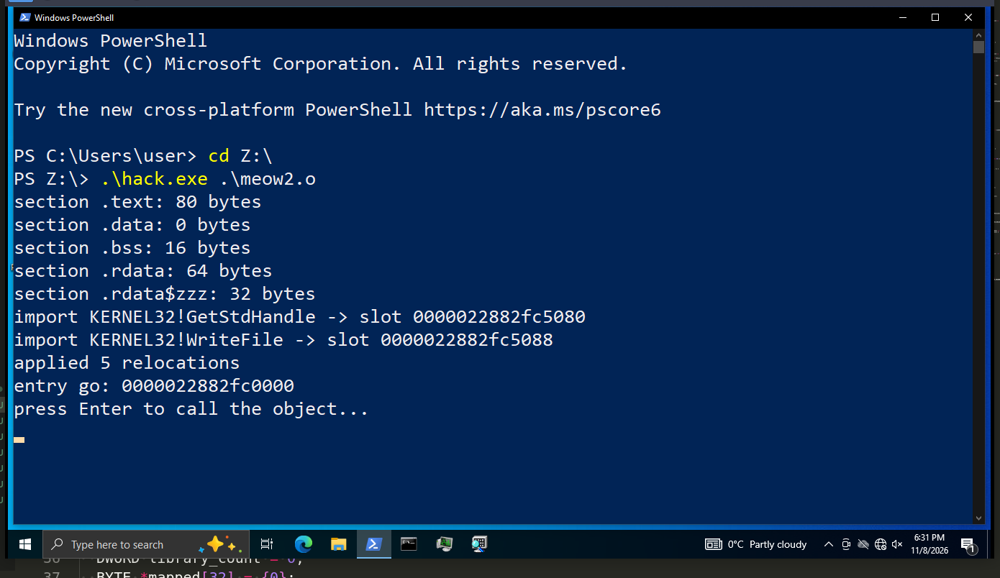{:class="img-responsive"}     

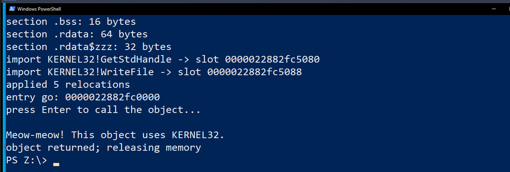{:class="img-responsive"}     

This is the independence check: the first object displays a dialog; the second writes to the console and uses a writable uninitialized variable. The loader discovers the different section references and API names from the input. Recompiling `hack.c` is unnecessary.    

An alternate entry name can be selected with `hack.exe object.o entry_name`. Its signature must still match the documented contract.    

Let me show with x64dbg.     

Start a fresh debugging session with the second object:    

```bash
init "Z:\hack.exe", "meow2.o", "Z:\"
```

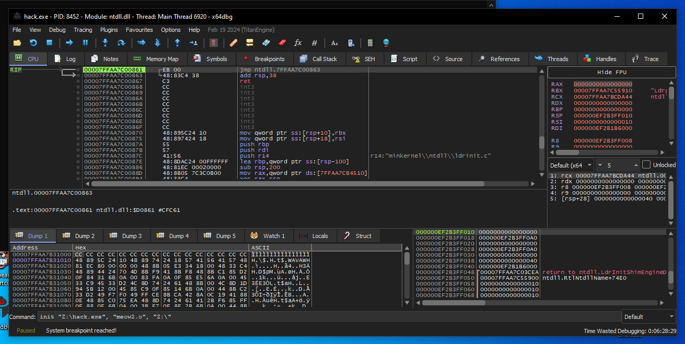{:class="img-responsive"}     

Press `F9`, wait for the console's Enter prompt, then pause the process with `F12`. 

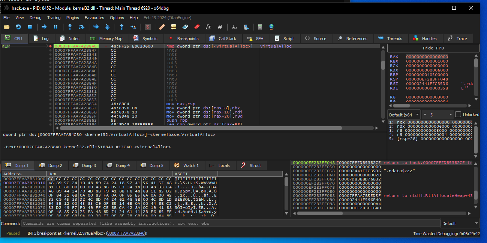{:class="img-responsive"}    

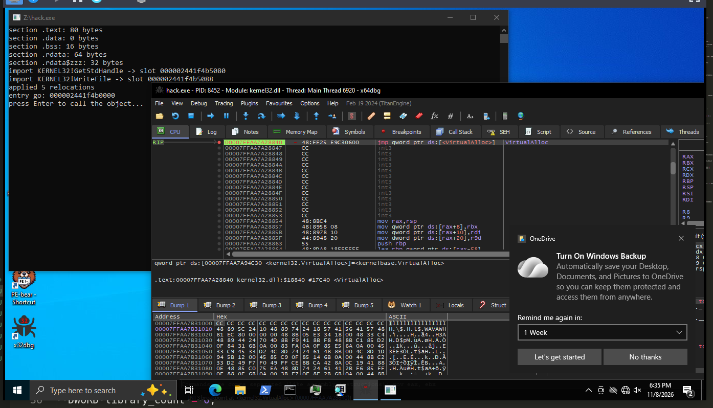{:class="img-responsive"}     

This time the console should list two import slots: `KERNEL32!GetStdHandle` and `KERNEL32!WriteFile`.

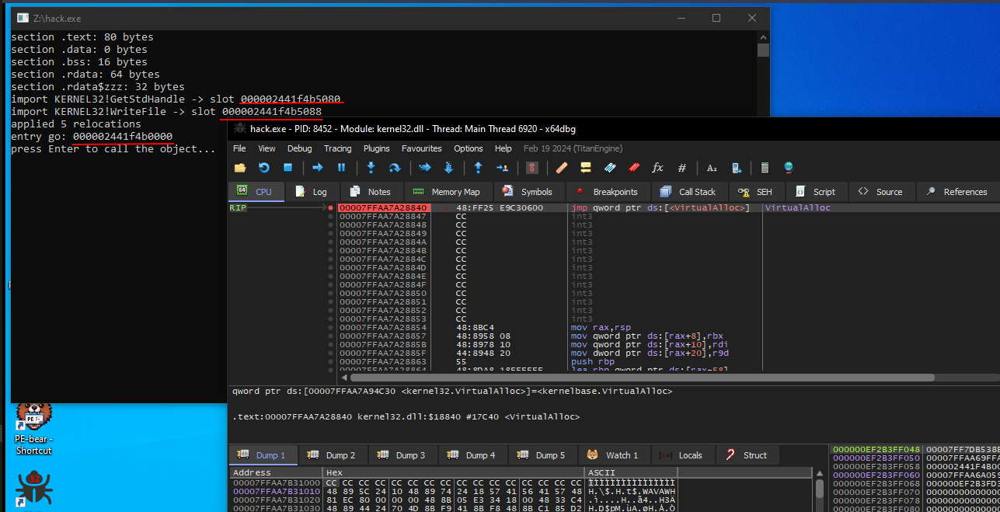{:class="img-responsive"}     

Copy the new entry address and the slot belonging to `WriteFile`:    

```bash
mov centry, <new address printed after entry go:>
mov wslot, <slot address printed for KERNEL32!WriteFile>
dump wslot
disasm qword:[wslot]
bp centry
bp qword:[wslot]
```

First:    

```bash
mov centry, 000002441f4b0000
```

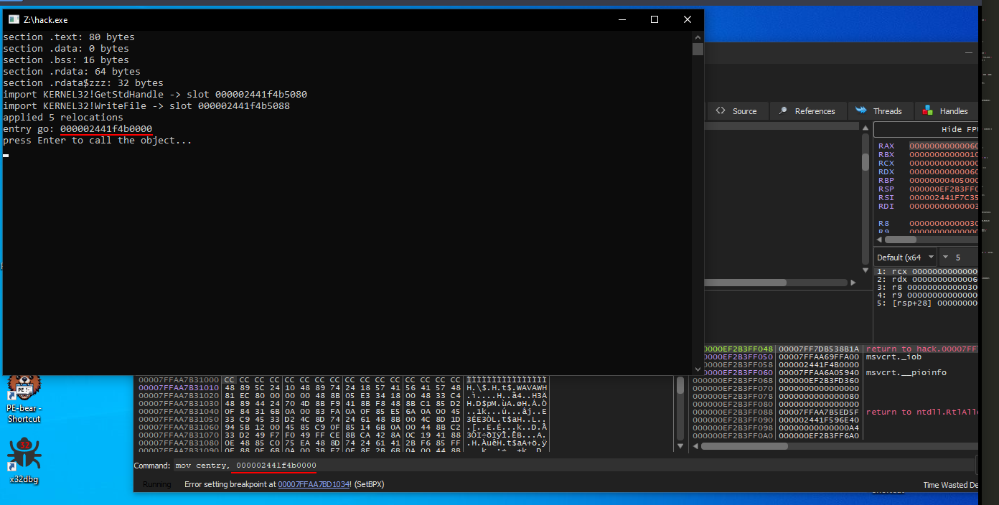{:class="img-responsive"}     

next:    

```bash
mov wslot, 000002441f4b5088
```

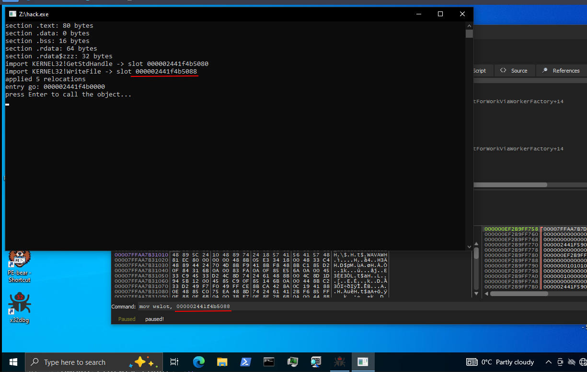{:class="img-responsive"}     

Then:    

```bash
dump wslot
disasm qword:[wslot]
bp centry
bp qword:[wslot]
```

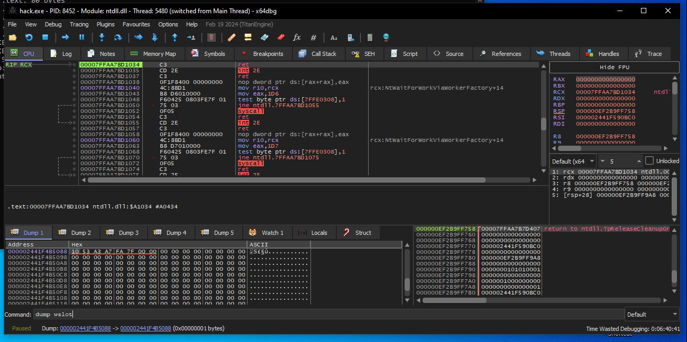{:class="img-responsive"}     

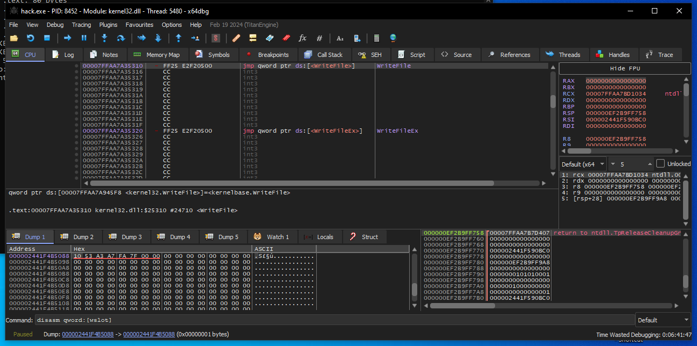{:class="img-responsive"}     

{:class="img-responsive"}     

{:class="img-responsive"}     

Use the addresses from this run. The slot may point to a forwarded implementation in another Windows DLL, so following its actual pointer is useful here.    

Press `F9`, then Enter in the console. At the `go()` breakpoint, save the host's return address before stepping:    

{:class="img-responsive"}     

```bash
mov cret, qword:[rsp]
bp cret
```

{:class="img-responsive"}     

{:class="img-responsive"}     

In the disassembly, locate the RIP-relative read and write of the `visits` variable. Follow their memory operand in Dump. The first DWORD should be zero before the increment; after stepping with `F8` past the store, it should be one. This is the mapped `.bss` storage supplied by the loader.    

{:class="img-responsive"}     

```nasm
mov eax, dword ptr ds:[2441F4B2000]  ; read visits
...
add eax, 1                           ; increment the value in EAX
mov dword ptr ds:[2441F4B2000], eax  ; write it back to visits
```

Continue with `F9` to the `WriteFile` breakpoint: 

{:class="img-responsive"}     

The Windows x64 argument layout should be:    

```bash
RCX        = standard-output handle
RDX        = pointer to the message
R8D        = message length in bytes
R9         = pointer to the written DWORD
[RSP+0x28] = 0, the fifth argument lpOverlapped
```

{:class="img-responsive"}     

Display the buffer:    

```bash
dump rdx
```

The ASCII column should show `Meow-meow! This object uses KERNEL32.` followed by the line-ending bytes. `R8D` should equal `sizeof(message) - 1` from the payload source.    


{:class="img-responsive"}     

Press `F9` to let the write complete. At `cret`, control has returned to the same loader used in demo 1. Continue and inspect the console output. We changed the object, its imports and its data references; the executable that loaded it stayed the same.    

{:class="img-responsive"}     

{:class="img-responsive"}     

{:class="img-responsive"}     

### a few limitations

This loader supports a deliberately small AMD64 COFF subset: ordinary section-defined symbols, absolute symbols, indirect named DLL imports using `__imp_DLL$Function`, `ADDR64`, and the `REL32` family. A single input object must contain all of its own function and data definitions. Auxiliary records are skipped; they are not treated as callable symbols.    

It rejects COMDAT sections, relocation-overflow tables, TLS, constructor sections, linker directives, unwind sections and alignments larger than the system page size. It does not implement multi-object linking, common-symbol allocation, weak-external resolution, import thunks for direct external calls, ordinal imports, a CRT startup routine or the Beacon API. A COFF extension alone is not a promise that an object meets this contract.    

The `__asm__` labels are a GCC source feature. A different compiler may require another way to produce the same external names. Extra compiler-generated dependencies such as stack-probing helpers must also be resolved or rejected; these small supplied objects do not request them.    

Loading the same object twice creates two fresh sets of sections. The host makes one synchronous call per run and releases everything after it returns. Exception propagation, callbacks retained after return, background threads and persistent pointers into that allocation are outside this example's lifetime contract. Process mitigations may also prohibit making dynamically allocated memory executable.    

### for blue teams

Let's use the debugger observations to explain what happened inside this process. The dialog is the chosen object's visible behavior. The loading mechanism prepares native code from a COFF file, resolves its dependencies and transfers control into that allocation. Other objects satisfying the same contract can request different APIs and implement different logic.    

*Where the instructions actually execute?*      

At the `centry` breakpoint, the instruction pointer belongs to our object's mapped `.text`. Record that address and inspect its memory region. The expected properties for this loader are:    

| location | type | current protection | what it contains |
|---|---|---|---|
| `centry` | `MEM_PRIVATE` (`0x20000`) | `PAGE_EXECUTE_READ` (`0x20`) | object instructions |
| `ctext`, in demo 1 | `MEM_PRIVATE` | `PAGE_READWRITE` (`0x04`) | relocated pointer to the message |
| `cslot` or `wslot` | `MEM_PRIVATE` | `PAGE_READONLY` (`0x02`) | resolved API pointer |
| destination stored in the slot | normally `MEM_IMAGE` | inspect the actual region | code in a loaded Windows DLL |

The mapped object sections and slots share an allocation. `AllocationBase` identifies its starting address; a region's `BaseAddress` may be different after protection changes split it into regions. Adjacent pages with identical attributes can also appear as one region, so Memory Map does not have to display one row per COFF section. These fields are described in [MEMORY_BASIC_INFORMATION](https://learn.microsoft.com/en-us/windows/win32/api/winnt/ns-winnt-memory_basic_information).    

For an external scanner, `VirtualQueryEx` queries the target process. The debugger's memory view provides a convenient way to examine the corresponding information in this lab. See [VirtualQuery](https://learn.microsoft.com/en-us/windows/win32/api/memoryapi/nf-memoryapi-virtualquery).    

Our allocation starts as writable memory, then its code pages become executable/read-only. Seeing the final RX protection does not mean the code was never writable. Conversely, an RX private page alone does not explain how its bytes were produced.    

In demo 1, we can follow this complete chain:    

{:class="img-responsive"}     

The debugger breakpoint on `centry` establishes execution of the object. The data dump establishes the relocated pointer's destination. The slot dump establishes which function the indirect reference reaches. The API breakpoint then lets us inspect the actual arguments. Together, these observations explain this execution path.    

There is a useful detail in our optimized first object: GCC emits a tail jump through the MessageBox import slot. At the API breakpoint, the stack's return address can therefore point directly into `hack.exe`. A simple return-address check would miss the intermediate object execution. Observe the entry and its transfer instruction as well as the API breakpoint; interpret a call stack with the actual disassembly in mind.    

Compare the object-file bytes with mapped bytes carefully. The `ADDR64` field in `.data` contains the addend `8` in our inspected build; in memory it contains the mapped `.rdata` address plus `8`. The RIP-relative fields also change when references are patched. These are expected relocation changes, so a raw byte mismatch alone is not evidence of an additional modification.    

{:class="img-responsive"}     

Inspecting only the PE import table of `hack.exe` gives an incomplete view of the APIs used during the run. The host contains the generic resolution logic, while the COFF symbols provide the object-specific DLL and function names.    

Demo 1 requests MessageBox. Demo 2 requests standard-output APIs and modifies a variable in `.bss`. The same host resolves both sets of symbols. An import into an object is also different from an API call actually observed at runtime: the loader resolves all supported undefined symbols before the entry executes, including any that the function might not use on a particular path.    

For this lab, collect the input object's path and hash, its undefined symbols, the addresses of their slots and the API calls reached during execution. That links the input artifact to its runtime behavior. The `__imp_DLL$Function` spelling is a useful artifact of this implementation's convention; other loaders can use other conventions.    

*Understand what endpoint logs can show*

The sequence established by the source and debugger is:    

```text
object file read
    -> private RW allocation and section copies
    -> symbol and API resolution
    -> relocation writes
    -> code pages changed to RX
    -> call into the object
    -> return and cleanup
```

An endpoint product may expose parts of this sequence, depending on its sensors and configuration. The debugger's complete view does not imply that ordinary event logs record every allocation, memory write or indirect call.    

For example, Sysmon Event ID 1 can provide the host process and command line. Event ID 7 can report an image load when that logging is enabled; it is disabled by default. An already loaded dependency need not generate another image-load event when the loader obtains another reference to it. Sysmon Event ID 8 describes creating a thread in another process, which this example does not do. Standard Sysmon events do not provide a general record of every COFF relocation or `VirtualProtect` call. See the [Sysmon event documentation](https://learn.microsoft.com/en-us/sysinternals/downloads/sysmon).    

Neither supplied object opens a network connection or starts a child process. Their absence is consistent with these examples. Establishing the object's execution requires evidence about memory and control flow, rather than expecting those unrelated activities to occur.    

*Capture evidence while the allocation exists*       

The most useful capture point is the loader's pause before `entry()`, or a breakpoint inside the object. Record the section bytes, slot contents, addresses and protections before allowing cleanup.    

After `go()` returns, the loader releases its allocation. The saved `centry`, `ctext` and slot addresses then become stale. A later memory query or dump may find freed memory, or an unrelated allocation that reused the address. A failed inspection after cleanup does not establish that the object never executed.    

For demo 2, the `.bss` variable's change from zero to one provides another observable data effect inside that allocation. The `WriteFile` buffer and length explain the console output. Neither observation depends on finding a MessageBox signature.    

*Describe the finding with the right scope*

A defensible lab finding would be: the process read this COFF object, resolved these symbols, executed its selected function from private executable memory, reached these Windows APIs and returned to the host. Keep the supporting input artifact, addresses and debugger observations with that finding.    

To decide whether similar behavior is malicious in an investigation, examine the process's purpose, provenance, inputs, surrounding activity and expected code-generation behavior. JIT engines, emulators and other legitimate applications also prepare executable memory. A private RX page, a missing PE header or a writable-to-executable transition alone does not establish malicious intent.    

Likewise, a YARA rule matching `Meow-meow!`, a compiler-identification string or this import-name convention can identify aspects of the sample. It does not establish that the code executed, and it does not cover every COFF loader. The useful blue-team lesson is the relationship between the input file, prepared memory, resolved references and observed execution.    

### conclusion

We moved from preparing a linked PE image to resolving a small object file ourselves. The practical mechanism is section placement, symbol resolution, import-pointer slots and object relocations. Both `Meow-meow` examples use that same mechanism while requesting different APIs.    

I hope this post is useful for malware researchers, C programmers, red teamers and blue teamers who investigate native code loading.    

[Microsoft: PE and COFF format](https://learn.microsoft.com/en-us/windows/win32/debug/pe-format)    
[GCC: assembler labels](https://gcc.gnu.org/onlinedocs/gcc/Asm-Labels.html)    
[Microsoft: VirtualAlloc](https://learn.microsoft.com/en-us/windows/win32/api/memoryapi/nf-memoryapi-virtualalloc)    
[Microsoft: LoadLibraryA](https://learn.microsoft.com/en-us/windows/win32/api/libloaderapi/nf-libloaderapi-loadlibrarya)    
[Microsoft: GetProcAddress](https://learn.microsoft.com/en-us/windows/win32/api/libloaderapi/nf-libloaderapi-getprocaddress)    
[Microsoft: VirtualProtect](https://learn.microsoft.com/en-us/windows/win32/api/memoryapi/nf-memoryapi-virtualprotect)    
[Microsoft: FlushInstructionCache](https://learn.microsoft.com/en-us/windows/win32/api/processthreadsapi/nf-processthreadsapi-flushinstructioncache)    
[Microsoft: VirtualQuery](https://learn.microsoft.com/en-us/windows/win32/api/memoryapi/nf-memoryapi-virtualquery)    
[Microsoft: MEMORY_BASIC_INFORMATION](https://learn.microsoft.com/en-us/windows/win32/api/winnt/ns-winnt-memory_basic_information)    
[Microsoft: Sysmon](https://learn.microsoft.com/en-us/sysinternals/downloads/sysmon)    
[source code in github](https://github.com/cocomelonc/meow/tree/master/2026-11-04-malware-tricks-69)    

> This is a practical case for educational purposes only.

Thanks for your time happy hacking and good bye!    
*PS. All drawings and screenshots are mine*
